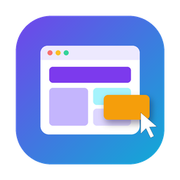
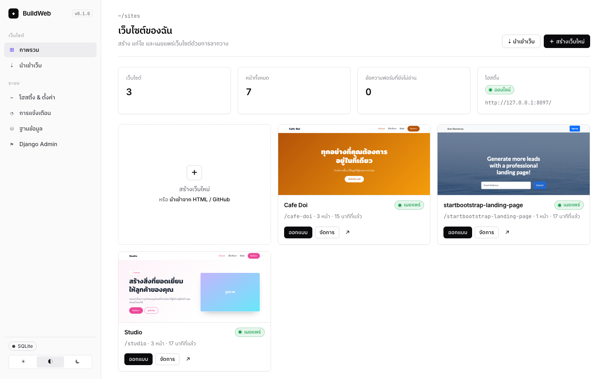

<div align="center">



# BuildWeb

**สร้างเว็บไซต์แบบลากวาง โฮสต์จาก Mac ของคุณ และส่งออกเป็น HTML/CSS/JS ได้ทันที**<br>
Drag-and-drop website builder for macOS: design, host and export real websites.

<a href="https://github.com/AImunich20/buildweb-releases/releases/latest/download/BuildWeb.dmg"></a>

<a href="https://github.com/AImunich20/buildweb-releases/releases/latest"></a>


<br><br>


</div>

---

## ติดตั้ง

1. **[ดาวน์โหลด BuildWeb.dmg](https://github.com/AImunich20/buildweb-releases/releases/latest/download/BuildWeb.dmg)** สำหรับ Mac ชิป Apple (M1/M2/M3/M4) และ macOS 12 ขึ้นไป
2. เปิดไฟล์ `.dmg` แล้วลาก **BuildWeb** ไปไว้ใน **Applications**
3. เปิด BuildWeb ครั้งแรก
   - ถ้า macOS บอกว่า *“ไม่สามารถตรวจสอบผู้พัฒนาได้”* ให้ไปที่ **System Settings › Privacy & Security** แล้วกด **Open Anyway**
   - หรือรันคำสั่งนี้ใน Terminal ครั้งเดียว: `xattr -dr com.apple.quarantine /Applications/BuildWeb.app`
4. การเปิดครั้งแรกจะติดตั้งส่วนประกอบเอง ต้องต่ออินเทอร์เน็ต และใช้เวลาประมาณหนึ่งนาที

> **อัพเดทอัตโนมัติเหมือนแอปทั่วไป:** BuildWeb ตรวจหาเวอร์ชันใหม่ทุกครั้งที่เปิดและทุกชั่วโมง เจอแล้วจะติดตั้งเองเบื้องหลัง
> และถามก่อนเปิดใหม่ ข้อมูลเว็บของคุณไม่หาย ปิดการติดตั้งอัตโนมัติได้ที่ **โฮสติ้ง & ตั้งค่า**

## ทำอะไรได้บ้าง

<table>
<tr><td width="50%">

### 🎨 ออกแบบแบบลากวาง
- มีบล็อกสำเร็จรูปภาษาไทย 19 แบบ: ฮีโร่, ราคา, รีวิว, ทีมงาน, FAQ, ฟอร์ม, แผนที่, วิดีโอ, เมนูร้าน ฯลฯ
- ดูหน้าจอคอม/แท็บเล็ต/มือถือ, undo/redo, ดูโค้ด, เวอร์ชันย้อนหลัง
- ธีมทั้งเว็บ: สี, ฟอนต์ไทยจาก Google Fonts, ความโค้งมุม
- **ส่วนหัว/ท้ายร่วม:** แก้ครั้งเดียวเปลี่ยนทุกหน้า และเมนูอัปเดตตามรายการหน้าเอง

</td><td>

### ⇣ นำเข้าเว็บที่มีอยู่
- จากไฟล์ `.html`, `.zip`, ทั้งโฟลเดอร์ หรือ **repo บน GitHub**
- ทุกหน้าแก้ด้วยการลากวางได้ทันที
- เก็บ CSS, JS, รูป และฟอนต์ไว้ครบ ลิงก์ระหว่างหน้าถูกแก้ให้เอง
- repo ส่วนตัวใช้ token ได้ และเลือก branch หรือโฟลเดอร์ย่อยได้

</td></tr>
<tr><td>

### 🌐 โฮสต์หลายเว็บพร้อมกัน
- ทุกเว็บเปิดได้ที่ `/ชื่อเว็บ/` หรือให้แต่ละเว็บมี**พอร์ตของตัวเอง**ก็ได้
- เครื่องอื่นใน Wi-Fi เดียวกันเปิดดูได้
- **Tailscale:** สวิตช์เดียวได้ `https://เครื่องคุณ.ts.net/` หรือใช้ Funnel เปิดให้คนทั่วไปบนอินเทอร์เน็ตเข้าได้
- ปิดหน้าต่างแล้วเว็บยังออนไลน์ เพราะแอปยังทำงานบนแถบเมนู

</td><td>

### 📦 ส่งออก & ฐานข้อมูล
- ส่งออกเป็น HTML/CSS/JS (โฟลเดอร์หรือ .zip) ลงเครื่อง หรือส่งตรงเข้า **XAMPP htdocs**
- ใช้ SQLite ได้ทันที หรือสลับไป **MySQL/MariaDB ของ XAMPP** ด้วยคลิกเดียว (ย้ายข้อมูลให้ครบ)
- ฟอร์มบนเว็บใช้ได้จริง ดูในแอป, ส่งออก CSV และ**แจ้งเตือน**ทาง macOS, Telegram, Discord, อีเมล หรือ Webhook

</td></tr>
</table>

<div align="center">
 
<br><sub>แดชบอร์ดมีธีมสว่าง/มืด/ตามระบบ · มี Django Admin ให้จัดการข้อมูลทั้งหมด</sub>
<br><br>
 
</div>

## คำถามที่พบบ่อย

<details><summary><b>ใช้กับ Mac ชิป Intel ได้ไหม?</b></summary>
ตอนนี้รองรับเฉพาะ Mac ชิป Apple (M1 ขึ้นไป)
</details>
<details><summary><b>ข้อมูลเว็บเก็บที่ไหน?</b></summary>

`~/Library/Application Support/com.buildweb.app/data/` มีฐานข้อมูล, ไฟล์ที่อัปโหลด และการตั้งค่า การอัพเดทโปรแกรมไม่ลบข้อมูลเหล่านี้
</details>
<details><summary><b>ให้คนนอกบ้านเข้าเว็บได้ยังไง?</b></summary>
เปิด Tailscale ในหน้า <b>โฮสติ้ง & ตั้งค่า</b> แล้วเลือก “ทุกคนบนอินเทอร์เน็ต (Funnel)” หรือส่งออกเป็นไฟล์ HTML ไปวางบนโฮสติ้งใดก็ได้
</details>
<details><summary><b>เว็บ React/Vue นำเข้าได้ไหม?</b></summary>
ได้ แต่ต้อง build ก่อน แล้วนำเข้าโฟลเดอร์ <code>dist/</code> หรือ <code>build/</code> (หรือชี้ลิงก์ GitHub ไปที่โฟลเดอร์นั้น)
</details>

---

## สำหรับนักพัฒนา

| ส่วน | เทคโนโลยี |
|---|---|
| แอปบน Mac | Tauri 2 (Rust): เริ่ม backend, แสดงหน้าต่าง, ไอคอนแถบเมนู, ระบบอัพเดท |
| Backend | Django 5.2 LTS + waitress, PyMySQL (รองรับ MariaDB 10.4 ของ XAMPP) |
| ตัวออกแบบ | GrapesJS 0.23 + ปลั๊กอิน (เก็บไว้ใน `backend/builder/static/vendor/grapesjs`) |
| Python | แอปแนบ `uv` ไปด้วย และสร้าง venv ส่วนตัวตอนเปิดครั้งแรก |

```sh
cd backend
uv venv --python 3.11 .venv && uv pip install --python .venv/bin/python -r requirements.txt
.venv/bin/python run.py                                       # http://127.0.0.1:5050
BUILDWEB_DATA=$(mktemp -d) .venv/bin/python manage.py test builder
```

แอปบน Mac: `npm install` แล้ว `npm run dev` (หรือ `npm run dmg` เพื่อทำ `.dmg` ในเครื่อง) อัปเดต GrapesJS ด้วย `npm run vendor`

### ปล่อยเวอร์ชันใหม่: แค่ push

ทุกครั้งที่ push ขึ้น `main` ไฟล์ [`.github/workflows/release.yml`](.github/workflows/release.yml) จะ:
1. รันเทสต์
2. ตั้งเลขเวอร์ชันถัดไป (+1 patch หรือใช้เลขใน `package.json` ถ้าตั้งให้สูงกว่า เช่น `node scripts/set-version.js 0.2.0`)
3. build และเซ็นบนเครื่อง Mac ของ GitHub
4. ปล่อยขึ้น [buildweb-releases](https://github.com/AImunich20/buildweb-releases/releases)

แอปที่ติดตั้งอยู่จะอัพเดทเองภายในหนึ่งชั่วโมง ใส่ `[skip release]` ในข้อความ commit ถ้าไม่ต้องการปล่อยเวอร์ชัน

Secrets ของ repo: `TAURI_SIGNING_PRIVATE_KEY` (เนื้อหาของ `~/.tauri/buildweb.key`) และ `RELEASES_TOKEN` (สิทธิ์สร้าง release ใน `buildweb-releases`)
