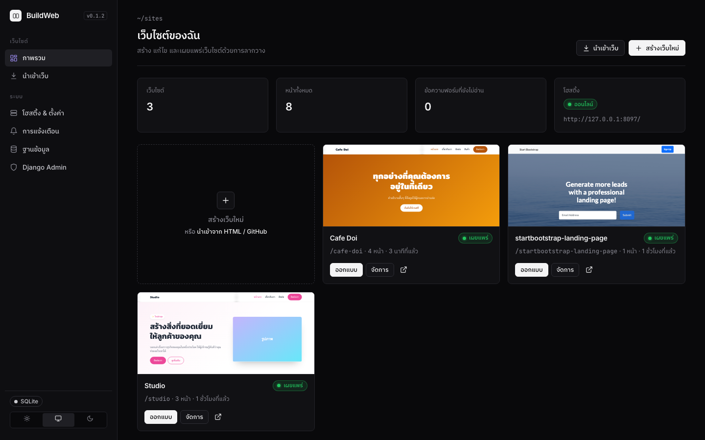

<div align="center">


<br>

**สร้างเว็บไซต์แบบลากวาง ผูกข้อมูลจาก MySQL/XAMPP โฮสต์จากเครื่องคุณ และส่งออกเป็น HTML/CSS/JS**

<a href="https://github.com/AImunich20/buildweb-releases/releases/latest"></a>


</div>

## ดาวน์โหลด

| ระบบ | ดาวน์โหลด | หมายเหตุ |
|---|---|---|
| **macOS** (Apple M1–M4) | <a href="https://github.com/AImunich20/buildweb-releases/releases/latest/download/BuildWeb.dmg"></a> | macOS 12 ขึ้นไป |
| **macOS** (Intel) | <a href="https://github.com/AImunich20/buildweb-releases/releases/latest/download/BuildWeb-Intel.dmg"></a> | macOS 12 ขึ้นไป |
| **Windows** 10/11 | <a href="https://github.com/AImunich20/buildweb-releases/releases/latest/download/BuildWeb-Setup.exe"></a> | 64-bit · ติดตั้งแบบผู้ใช้ ไม่ต้องใช้สิทธิ์แอดมิน |
| **Linux** | <a href="https://github.com/AImunich20/buildweb-releases/releases/latest/download/BuildWeb.AppImage"></a> <a href="https://github.com/AImunich20/buildweb-releases/releases/latest/download/BuildWeb.deb"></a> | x86_64 · AppImage อัพเดทตัวเองได้ |

**อัพเดทเหมือนแอปทั่วไป:** BuildWeb ตรวจหาเวอร์ชันใหม่ตอนเปิดและทุกชั่วโมง แล้วติดตั้งให้เองเบื้องหลัง ข้อมูลเว็บของคุณไม่หาย

<details>
<summary><b>ติดตั้งครั้งแรก: macOS แจ้งว่า “ไม่สามารถตรวจสอบผู้พัฒนาได้”</b></summary>

BuildWeb ยังไม่ได้ลงทะเบียนกับ Apple ให้ทำอย่างใดอย่างหนึ่ง
- **System Settings › Privacy & Security** แล้วกด **Open Anyway**
- หรือรันใน Terminal ครั้งเดียว: `xattr -dr com.apple.quarantine /Applications/BuildWeb.app`

บน Windows ถ้า SmartScreen เตือน ให้กด **More info › Run anyway** · บน Linux ให้ `chmod +x BuildWeb.AppImage` ก่อนเปิด
การเปิดครั้งแรกจะติดตั้งส่วนประกอบเอง (ต้องต่ออินเทอร์เน็ต และใช้เวลาประมาณหนึ่งนาที)
</details>

<br>

## ทำอะไรได้บ้าง

<table>
<tr>
<td width="50%" valign="top">

#### ออกแบบแบบลากวาง
บล็อกสำเร็จรูปภาษาไทย 19 แบบ, ธีมสี/ฟอนต์ทั้งเว็บ, ดูได้ทั้งคอม/แท็บเล็ต/มือถือ, undo/redo, เวอร์ชันย้อนหลัง และ**ส่วนหัว/ท้ายร่วม**ที่แก้ครั้งเดียวเปลี่ยนทุกหน้า โดยเมนูอัปเดตตามรายการหน้าเอง

</td>
<td width="50%" valign="top">

#### ข้อมูลจาก MySQL / XAMPP
นำเข้าตารางจาก XAMPP ได้ 2 แบบ: **คัดลอก** มาเก็บ หรือ**เชื่อมสด** (แก้ใน phpMyAdmin แล้วเว็บเปลี่ยนตาม) รองรับไฟล์ `.sql` และ CSV ด้วย
ผูกกับบล็อกใดก็ได้: วนซ้ำ เรียง กรอง จำกัดจำนวน และใช้ `{{ฟิลด์}}` ในข้อความ รูป หรือลิงก์

</td>
</tr>
<tr>
<td valign="top">

#### นำเข้าเว็บที่มีอยู่
จาก `.html`, `.zip`, ทั้งโฟลเดอร์ หรือ **repo บน GitHub** ทุกหน้าแก้แบบลากวางได้ทันที โดยเก็บ CSS/JS/รูป/ฟอนต์ไว้ครบ และแก้ลิงก์ระหว่างหน้าให้เอง

</td>
<td valign="top">

#### โฮสต์หลายเว็บพร้อมกัน
แต่ละเว็บมีพอร์ตของตัวเองได้ เปิดดูจากเครื่องใน Wi-Fi เดียวกันได้ และใช้ **Tailscale** เป็น `https://เครื่องคุณ.ts.net/` ได้ด้วยสวิตช์เดียว (Funnel เปิดสู่อินเทอร์เน็ต)
ปิดหน้าต่างแล้วเว็บยังออนไลน์ เพราะแอปทำงานต่อบนแถบเมนู

</td>
</tr>
<tr>
<td valign="top">

#### ฟอร์ม & การแจ้งเตือน
ฟอร์มบนเว็บใช้งานได้จริง ข้อมูลเก็บลงฐานข้อมูล ส่งออก CSV ได้ และแจ้งเตือนทันทีผ่าน**การแจ้งเตือนบนเครื่อง, Telegram, Discord, อีเมล หรือ Webhook**

</td>
<td valign="top">

#### ส่งออก & ผู้ดูแล
ส่งออกเป็น HTML/CSS/JS ลงเครื่อง หรือส่งตรงเข้า **XAMPP htdocs** (มี `bw-form.php` รับฟอร์มลง MySQL) ใช้ฐานข้อมูล SQLite หรือ MySQL ได้ มี **Django Admin** และธีมสว่าง/มืด

</td>
</tr>
</table>

<div align="center">
 
 
</div>

## ตัวอย่าง: แสดงสินค้าจาก XAMPP

1. **ข้อมูล › นำเข้าจาก MySQL / XAMPP** เลือก database และตาราง `products` แล้วเลือก **เชื่อมสด**
2. ในตัวออกแบบ ลากบล็อก **products (การ์ด)** จากหมวด “ข้อมูล” ลงหน้า เสร็จแล้ว
3. หรือเขียนเองก็ได้:

```html
<div data-bw-repeat="products" data-bw-sort="price" data-bw-order="desc" data-bw-limit="6">
  <h3>{{name}}</h3>  <b>฿{{price}}</b>
</div>
<p>มีสินค้า {{products.count}} รายการ</p>
```

ตัวกรอง: `data-bw-filter="category=coffee;price>50"` (`=`, `!=`, `~` มีคำนี้, `>`, `<`, `>=`, `<=`) · `{{{field}}}` = HTML ไม่ escape · `{{#}}` = ลำดับแถว

## คำถามที่พบบ่อย

<details><summary><b>ข้อมูลเว็บเก็บที่ไหน?</b></summary>

- macOS: `~/Library/Application Support/com.buildweb.app/data/`
- Windows: `%APPDATA%\com.buildweb.app\data\`
- Linux: `~/.local/share/com.buildweb.app/data/`

การอัพเดทไม่ลบข้อมูลเหล่านี้
</details>
<details><summary><b>ให้คนนอกบ้านเข้าเว็บได้ยังไง?</b></summary>
เปิด Tailscale ในหน้า <b>โฮสติ้ง & ตั้งค่า</b> แล้วเลือก “ทุกคนบนอินเทอร์เน็ต (Funnel)” หรือส่งออกเป็นไฟล์ HTML ไปวางบนโฮสติ้งใดก็ได้
</details>
<details><summary><b>เว็บ React/Vue นำเข้าได้ไหม?</b></summary>
ได้ แต่ต้อง build ก่อน แล้วนำเข้าโฟลเดอร์ <code>dist/</code> หรือ <code>build/</code>
</details>

---

<details>
<summary><b>สำหรับนักพัฒนา</b></summary>

| ส่วน | เทคโนโลยี |
|---|---|
| แอป | Tauri 2 (Rust): หน้าต่าง, ไอคอนแถบเมนู, ระบบอัพเดท. บน macOS backend รันเป็น launchd job แยก จึงไม่หยุดเมื่อปิดหน้าต่าง |
| Backend | Django 5.2 LTS + waitress, PyMySQL (รองรับ MariaDB 10.4 ของ XAMPP) |
| ตัวออกแบบ | GrapesJS 0.23 + ปลั๊กอิน (เก็บไว้ใน `backend/builder/static/vendor/grapesjs`) |
| Python | แอปแนบ `uv` ไปด้วย และสร้าง venv ส่วนตัวตอนเปิดครั้งแรก |

```sh
cd backend
uv venv --python 3.11 .venv && uv pip install --python .venv/bin/python -r requirements.txt
.venv/bin/python run.py                                       # http://127.0.0.1:5050
BUILDWEB_DATA=$(mktemp -d) .venv/bin/python manage.py test builder
```

**ปล่อยเวอร์ชันใหม่ = push ขึ้น `main`.** ไฟล์ [`release.yml`](.github/workflows/release.yml) จะรันเทสต์ แล้ว build และเซ็นแยกทุกระบบพร้อมกัน (macOS arm64/x64, Windows, Linux) จากนั้นปล่อยเป็น release เดียวใน [buildweb-releases](https://github.com/AImunich20/buildweb-releases/releases) พร้อม `latest.json` สำหรับทุกระบบ
- เลขเวอร์ชันขึ้นเอง (+1 patch) หรือตั้งเองด้วย `node scripts/set-version.js 0.2.0`
- ใส่ `[skip release]` ในข้อความ commit ถ้าไม่ต้องการปล่อย
- Secrets ที่ต้องตั้ง: `TAURI_SIGNING_PRIVATE_KEY` (จาก `~/.tauri/buildweb.key`) และ `RELEASES_TOKEN`
</details>
