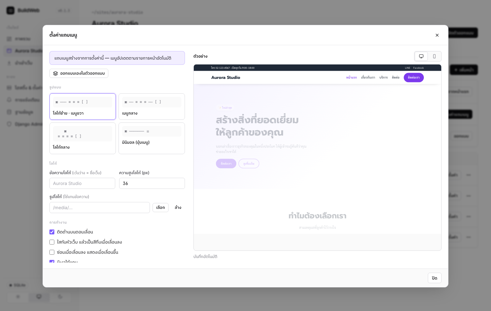
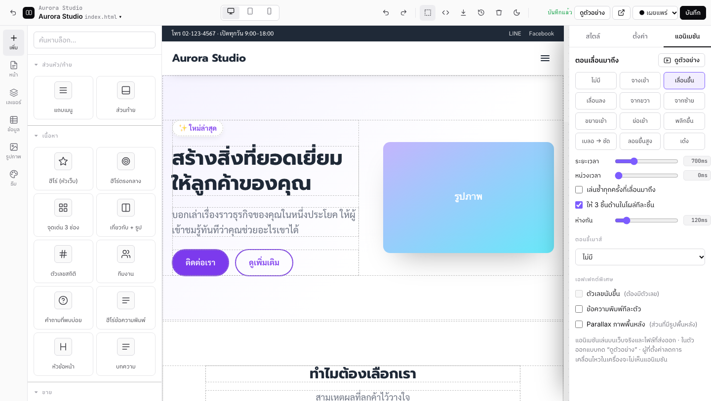
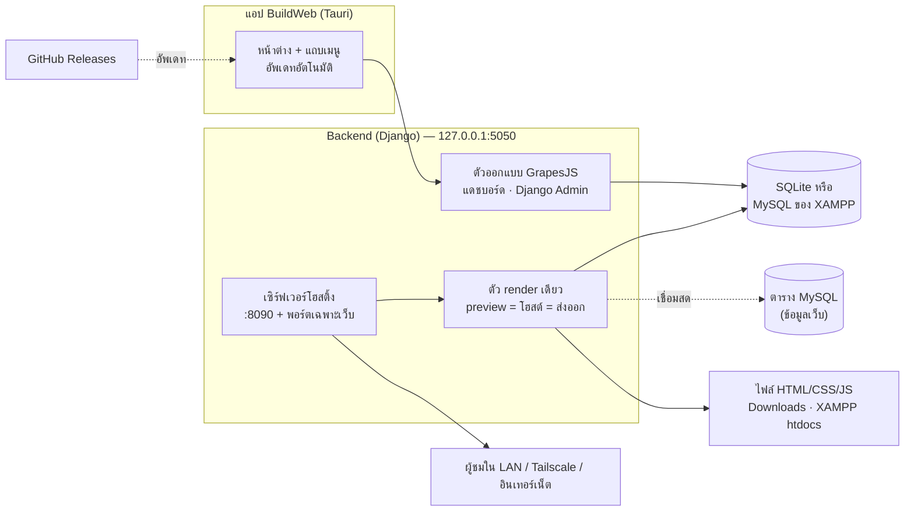

<div align="center">


<br>

**โปรแกรมสร้างเว็บไซต์แบบลากวางบนเครื่องของคุณ**<br>
ออกแบบเหมือน Canva · ผูกข้อมูลจาก MySQL/XAMPP · บล็อก & หน้ารายละเอียดอัตโนมัติ · เผยแพร่ขึ้น GitHub Pages/Netlify/FTP ปุ่มเดียว · โฮสต์หลายเว็บพร้อมกัน · อัพเดทตัวเองอัตโนมัติ

<a href="https://github.com/AImunich20/buildweb-releases/releases/latest"></a>


[ดาวน์โหลด](#ดาวน์โหลด) · [ฟีเจอร์](#ฟีเจอร์ทั้งหมด) · [เริ่มต้นใช้งาน](#เริ่มต้นใช้งานใน-5-นาที) · [ทำงานอย่างไร](#ทำงานอย่างไร) · [คู่มืออ้างอิง](#คู่มืออ้างอิง) · [คำถามที่พบบ่อย](#คำถามที่พบบ่อย--แก้ปัญหา) · [CHANGELOG](CHANGELOG.md)

</div>

---

## ดาวน์โหลด

| ระบบ | ดาวน์โหลด | หมายเหตุ |
|---|---|---|
| **macOS** (Apple M1–M4) | <a href="https://github.com/AImunich20/buildweb-releases/releases/latest/download/BuildWeb.dmg"></a> | macOS 12 ขึ้นไป |
| **macOS** (Intel) | <a href="https://github.com/AImunich20/buildweb-releases/releases/latest/download/BuildWeb-Intel.dmg"></a> | macOS 12 ขึ้นไป |
| **Windows** 10/11 | <a href="https://github.com/AImunich20/buildweb-releases/releases/latest/download/BuildWeb-Setup.exe"></a> | 64-bit · ไม่ต้องใช้สิทธิ์แอดมิน |
| **Linux** | <a href="https://github.com/AImunich20/buildweb-releases/releases/latest/download/BuildWeb.AppImage"></a> <a href="https://github.com/AImunich20/buildweb-releases/releases/latest/download/BuildWeb.deb"></a> | x86_64 · AppImage อัพเดทตัวเองได้ |

> **ติดตั้งครั้งเดียว ใช้ได้ตลอด** BuildWeb ตรวจหาเวอร์ชันใหม่ตอนเปิดและทุกชั่วโมง แล้วติดตั้งให้เองเบื้องหลัง (ถามก่อนเปิดใหม่) ข้อมูลเว็บไม่หาย

<details>
<summary><b>เปิดครั้งแรกแล้วระบบเตือนเรื่องความปลอดภัย?</b></summary>

BuildWeb ยังไม่ได้ซื้อใบรับรองนักพัฒนาจาก Apple/Microsoft ระบบจึงเตือนในครั้งแรก
- **macOS:** ไปที่ System Settings › Privacy & Security แล้วกด **Open Anyway** หรือรัน `xattr -dr com.apple.quarantine /Applications/BuildWeb.app`
- **Windows:** หน้าต่าง SmartScreen ให้กด **More info › Run anyway**
- **Linux:** `chmod +x BuildWeb.AppImage && ./BuildWeb.AppImage` หรือ `sudo apt install ./BuildWeb.deb`

การเปิดครั้งแรกจะติดตั้งส่วนประกอบเอง ต้องต่ออินเทอร์เน็ต และใช้เวลาประมาณหนึ่งนาที
</details>

---

## ฟีเจอร์ทั้งหมด

### 1. ตัวออกแบบแบบลากวาง


| ส่วน | ทำอะไรได้ |
|---|---|
| **บล็อกสำเร็จรูป 22 แบบ** (ภาษาไทย) | แถบเมนู, ฮีโร่ 3 แบบ, จุดเด่น, เกี่ยวกับเรา, สถิติ, แกลเลอรี, สไลด์รูป, แถบโลโก้วิ่ง, ราคา, รีวิว, ทีมงาน, FAQ, CTA, ฟอร์มติดต่อ, แผนที่, YouTube, เมนูร้าน, บทความ, ส่วนท้าย |
| **องค์ประกอบพื้นฐาน** | หัวข้อ, ย่อหน้า, ปุ่ม, รูป, วิดีโอ, คอลัมน์, ช่องว่าง, ฟอร์ม, แท็บ, นับถอยหลัง, โค้ด HTML เอง |
| **ปรับแต่ง** | แท็บ **สไตล์** (ฟอนต์ไทย, สี, ระยะ, ขอบ, เงา, flex/grid), แท็บ **ตั้งค่า** (ลิงก์ไปหน้าในเว็บ, alt, ฟอร์ม, วนซ้ำข้อมูล), แท็บ **แอนิเมชัน** |
| **มุมมอง** | คอมพิวเตอร์ / แท็บเล็ต / มือถือ แยกสไตล์ตามขนาดจอได้ |
| **ความปลอดภัยของงาน** | บันทึกอัตโนมัติทุกการแก้, undo/redo, **เวอร์ชันย้อนหลัง** (อัตโนมัติทุก 5 นาที + บันทึกเองตั้งชื่อได้) |
| **โค้ด** | ดูโค้ด HTML/CSS, นำเข้า HTML (วางโค้ดหรือเลือกไฟล์ .html) |
| **ธีมทั้งเว็บ** | สีหลัก/รอง/เน้น, ฟอนต์หัวข้อ/เนื้อหา (Prompt, Kanit, Sarabun, Noto Sans Thai, …), ความโค้งมุม, ความกว้าง เปลี่ยนแล้วทุกบล็อกเปลี่ยนตาม |

### 2. แถบเมนูที่ตั้งค่าได้ — ใหม่ใน v0.1.3



- **4 รูปแบบ:** โลโก้ซ้าย/เมนูขวา · เมนูกลาง · โลโก้กลาง · มินิมอล (ปุ่มเมนูอย่างเดียว)
- **โลโก้:** ข้อความหรือรูป (ปรับความสูงได้)
- **การทำงาน:** ติดด้านบนตอนเลื่อน · ใสทับหัวเว็บแล้วเป็นสีทึบเมื่อเลื่อน · ซ่อนเมื่อเลื่อนลง/แสดงเมื่อเลื่อนขึ้น · เงา · ความสูง · สีพื้น/ตัวอักษร
- **มือถือ:** เลื่อนจากด้านข้าง (drawer) · ดรอปดาวน์ · เต็มจอ (ปิดด้วย Esc หรือแตะพื้นหลังได้)
- **เมนู:** *อัตโนมัติ* จากรายการหน้า (หน้าย่อยกลายเป็น dropdown, ไฮไลต์หน้าปัจจุบัน) หรือ *จัดเอง* (ลิงก์ภายนอก, `#section`, เมนูย่อย, เปิดแท็บใหม่)
- **ปุ่มเด่น (CTA)** และ **แถบบน** สำหรับเบอร์โทร/เวลาเปิด/ลิงก์โซเชียล
- พรีวิวสด (คอม/มือถือ) และบันทึกอัตโนมัติ อยากออกแบบเองทั้งหมดก็กด “ออกแบบเองในตัวออกแบบ”

### 3. แอนิเมชัน — ใหม่ใน v0.1.3



เลือกองค์ประกอบ › แท็บ **แอนิเมชัน** › คลิกเลือก แล้วกด **ดูตัวอย่าง** ได้ทันที
- **ตอนเลื่อนมาถึง 11 แบบ:** จางเข้า, เลื่อนขึ้น/ลง, จากซ้าย/ขวา, ขยาย/ย่อเข้า, พลิกขึ้น, เบลอ→ชัด, ลอยขึ้นสูง, เด้ง ปรับระยะเวลา/หน่วงเวลา และเล่นซ้ำได้
- **โผล่ทีละชิ้น (stagger):** ใช้กับกล่องที่มีหลายชิ้น เช่น การ์ด 3 ใบ หรือรายการจากฐานข้อมูล
- **ตอนชี้เมาส์ 6 แบบ:** ยกลอย, ขยาย, เรืองแสง, ซูมรูปข้างใน, เอียง 3D, แสงวาบ
- **เอฟเฟกต์พิเศษ:** ตัวเลขนับขึ้น (`1,200+`), ข้อความพิมพ์ทีละตัววนหลายคำ, parallax พื้นหลัง, สไลด์รูปเลื่อนเอง, แถบโลโก้วิ่ง
- บล็อกสำเร็จรูปมีแอนิเมชันพอดีๆ ใส่ไว้ให้แล้ว · ไม่ใช้ไลบรารีภายนอก เว็บจึงยังโหลดเร็ว · เคารพการตั้งค่า “ลดการเคลื่อนไหว” ของผู้ชม · ใช้ได้ในไฟล์ที่ส่งออกด้วย

### 4. ข้อมูลจาก MySQL / XAMPP


- **นำเข้าจาก:** การเชื่อมต่อ MySQL/MariaDB (เลือก database › ตาราง), ไฟล์ `.sql` ที่ export จาก phpMyAdmin (ดูตารางก่อนนำเข้า), CSV หรือสร้างเอง
- **2 โหมด**
  - **คัดลอก:** เก็บใน BuildWeb แก้ได้ในแอป (ตารางแก้ไขได้ทีละช่อง) กด “ซิงก์” เพื่อดึงใหม่
  - **เชื่อมสด:** อ่านจาก MySQL ทุกครั้งที่มีคนเปิดเว็บ (แคช 15 วินาที) แก้ใน phpMyAdmin แล้วเว็บเปลี่ยนตาม
- **ผูกกับหน้าเว็บ:** ลากบล็อก “ข้อมูล › (ชื่อตาราง) การ์ด/ตาราง” หรือเลือกกล่องใดก็ได้ › ตั้งค่า › **วนซ้ำจากข้อมูล** แล้วใส่ `{{ฟิลด์}}` ในข้อความ รูป หรือลิงก์ — ดู [ไวยากรณ์](#ไวยากรณ์ข้อมูล)
- ระบบเดาชนิดฟิลด์ให้ (ตัวเลข, รูป, ลิงก์, วันที่, ข้อความยาว) · ส่งออก CSV ได้
- **แก้ไขทีละแถวแบบเต็ม** — ช่องตามชนิดฟิลด์, ปุ่มเลือกรูป, ตัวแก้ไขข้อความ (หัวข้อ ตัวหนา รายการ ลิงก์ รูป) สำหรับฟิลด์ HTML

### 4.0 Backend & REST API — ใหม่ใน v0.2


ทุกชุดข้อมูลมี **REST API** ให้ทันที ที่ `http://<โฮสต์>/<เว็บ>/api/v1/<ชุดข้อมูล>` — ใช้กับแอปมือถือ, หน้าเว็บอื่น, ระบบหลังร้าน, n8n/Zapier

```bash
curl 'http://192.168.1.10:8090/bean-cafe/api/v1/products?sort=-price&per_page=6&filter=price>50'
curl -X POST 'http://…/api/v1/orders' -H 'X-API-Key: bw_…' -H 'Content-Type: application/json' -d '{"product": 3, "qty": 2}'
```

| | |
|---|---|
| Endpoint | `GET /<ชุด>` · `POST /<ชุด>` · `GET/PATCH/PUT/DELETE /<ชุด>/<_id>` · `GET /openapi.json` |
| พารามิเตอร์ | `page` `per_page` (≤200) · `sort=-price,name` · `q` · `filter=price>50;category=coffee` · `ฟิลด์=ค่า` · `expand=author` · `fields=name,price` |
| สิทธิ์ | ต่อชุดข้อมูล × การกระทำ: ทุกคน / ต้องมี API key / ปิด · ฟิลด์ “ซ่อนจาก API” ไม่ถูกส่งออก |
| API key | อ่านอย่างเดียว หรืออ่าน+เขียน · จำกัดชุดข้อมูลได้ · ยกเลิกได้ทันที · เก็บแค่แฮช (`X-API-Key` หรือ `Authorization: Bearer`) |
| ความปลอดภัย | CORS ตามโดเมน, จำกัดครั้งต่อนาที, บันทึกการเรียก 30 วัน, API ปิดไว้จนกว่าจะเปิดเอง |
| ตรวจข้อมูล | ชนิด + กฎของฟิลด์ (จำเป็น, ห้ามซ้ำ, ต่ำสุด/สูงสุด, regex, ตัวเลือก, relation) — ผิดได้ `422` พร้อมข้อความทุกช่อง |
| MySQL / XAMPP | ชุดข้อมูลแบบเชื่อมสด อ่าน-เขียนตารางจริงผ่าน API |
| เครื่องมือ | แท็บ “API” มีตัวทดลองเรียก + โค้ด curl/fetch/PHP/Python, เอกสาร endpoint, บันทึกการเรียก, `openapi.json` สำหรับ Postman/Swagger |
| ในหน้าเว็บ | `bw.list('products', {sort: '-price'})` · `bw.create('reviews', {...})` · `bw.update()` · `bw.remove()` |

**ฟิลด์:** ข้อความ, ข้อความยาว, HTML, ตัวเลข, ใช่/ไม่, วันที่, วันเวลา, อีเมล, ลิงก์, รูป, ตัวเลือก, **เชื่อมชุดข้อมูล** (หนึ่ง/หลายแถว), JSON — ในหน้าเว็บใช้ `{{author.name}}` ดึงค่าจากแถวที่เชื่อมได้

> API ทำงานบนเซิร์ฟเวอร์โฮสติ้งของ BuildWeb (เครื่องนี้, LAN, Tailscale) · เว็บที่เผยแพร่ไป GitHub Pages/Netlify/FTP เป็นไฟล์อย่างเดียว — การ deploy backend ขึ้นเซิร์ฟเวอร์อยู่ในเฟส 4

### 4.1 หน้ารายละเอียด, ค้นหา & บทความ — ใหม่ใน v0.1.4


- **หน้ารายละเอียดของทุกแถว:** กดปุ่มเดียวได้หน้ารายการ `products.html` และหน้าของแต่ละแถว `product/latte.html` (ภาษาไทยในลิงก์ได้) พร้อมปุ่มก่อนหน้า/ถัดไป · ชื่อเรื่อง คำอธิบาย และรูปตอนแชร์ของแต่ละหน้าดึงจากข้อมูลแถวนั้นให้เอง · ใช้ `{{_url}}` ทำลิงก์จากการ์ดไปหน้ารายละเอียด
- **ค้นหา · ปุ่มหมวดหมู่ · แบ่งหน้า** ในกล่องข้อมูลใดก็ได้ (เลขหน้า หรือปุ่ม “โหลดเพิ่ม”) ทำงานในเบราว์เซอร์ จึงใช้ได้ทั้งตอนโฮสต์และหลังส่งออก
- **ระบบบทความ (Blog):** ปุ่ม “สร้างระบบบทความ” ได้ชุดข้อมูลบทความ + หน้ารวม (ค้นหา/หมวดหมู่/แบ่งหน้า) + หน้าอ่าน + **RSS** (`rss.xml`) เขียนบทความด้วยตัวแก้ไขข้อความในแอป
- **ฟอร์มบันทึกลงชุดข้อมูล:** รีวิว สมัครสมาชิก สมุดเยี่ยม — ข้อมูลเข้าชุดข้อมูลแล้ว**รออนุมัติ**ก่อนขึ้นเว็บ (หรืออนุมัติอัตโนมัติ) · ชุดข้อมูลแบบเชื่อมสดบันทึกลงตาราง MySQL ของ XAMPP โดยตรง (ใช้คอลัมน์ `approved` ถ้ามี) · มีกันสแปม (honeypot + จำกัดความถี่)
- **ตัวแปลงค่า:** `{{price|number}}` → 1,250 · `{{date|date}}` → 28 ต.ค. 2569 · `{{detail|truncate:120}}` · แสดงเฉพาะเมื่อมีค่า: `data-bw-if="image"`


### 5. นำเข้าเว็บที่มีอยู่

จาก `.html`, `.zip`, **ทั้งโฟลเดอร์** (ลากมาวาง) หรือ **repo บน GitHub** (public หรือ private ด้วย token, เลือก branch/โฟลเดอร์ย่อยได้, หา `dist/` ให้อัตโนมัติ)
- ทุกไฟล์ .html กลายเป็นหน้าที่แก้แบบลากวางได้ · CSS ที่ลิงก์ไว้ไปเป็น CSS ของเว็บ · JS ถูกเก็บไว้ · รูป/ฟอนต์/ไฟล์เข้าคลังไฟล์ · ลิงก์ระหว่างหน้าถูกแก้ให้
- `<header>`/`<footer>` ที่ซ้ำกันหลายหน้าถูกแยกเป็นส่วนร่วมอัตโนมัติ
- หน้าตาเหมือนต้นฉบับ (ปิดสไตล์พื้นฐานของ BuildWeb ให้เอง)

### 6. หน้าเว็บ, SEO และส่วนหัว/ท้ายร่วม

- เพิ่มหน้าพร้อมรูปแบบเริ่มต้น 7 แบบ · ชื่อไฟล์ · ฉบับร่าง/เผยแพร่ · หน้าแม่ (เมนูย่อย) · ลากจัดลำดับเมนู · ทำสำเนา · ตั้งหน้าแรก
- **SEO:** ชื่อเรื่อง, คำอธิบาย (นับตัวอักษร), คีย์เวิร์ด, รูปตอนแชร์ (og:image), noindex, โค้ดใน `<head>`/CSS/JS เฉพาะหน้า
- **คะแนน SEO ทุกหน้า (ใหม่):** ตรวจชื่อเรื่อง คำอธิบาย H1 รูปไม่มี alt เนื้อหา ลิงก์เสีย พร้อมคำแนะนำภาษาไทย · **ตัวอย่างตอนแชร์ลง Facebook/LINE** · สร้าง `sitemap.xml`, `robots.txt`, canonical และ og:url ให้อัตโนมัติ (ตั้ง “ที่อยู่เว็บจริง” หรือเผยแพร่ด้วยปุ่มเดียว)
- **ส่วนหัว/ท้ายร่วม:** แก้ครั้งเดียวเปลี่ยนทุกหน้า แต่ละหน้าเลือกไม่ใช้ได้

### 7. ไฟล์ & รูปภาพ

ลากไฟล์มาวาง (มีแถบความคืบหน้า), โฟลเดอร์, ค้นหา/กรองชนิด, เปลี่ยนชื่อหรือย้าย (หน้าที่ใช้ไฟล์ถูกแก้ลิงก์ให้), alt text, ป้องกันการลบไฟล์ที่ยังถูกใช้

### 8. ฟอร์ม & การแจ้งเตือน

**ปุ่มติดต่อลอย (ใหม่):** โทร · LINE (@OA หรือ ID) · Messenger · WhatsApp · Facebook · อีเมล · แผนที่ แบบปุ่มเรียง ปุ่มเดียวกดแล้วกาง หรือแถบล่างบนมือถือ พร้อมตัวอย่างสด

ฟอร์มบนเว็บใช้งานได้จริง ข้อมูลบันทึกลงฐานข้อมูล อ่าน/ลบ/ทำเครื่องหมายอ่านแล้ว ส่งออก CSV (เปิดใน Excel ภาษาไทยไม่เพี้ยน) แจ้งเตือนทันทีทาง **การแจ้งเตือนบนเครื่อง · Telegram · Discord · อีเมล (SMTP) · Webhook** (n8n, Make, Zapier) และมีปุ่มทดสอบทุกช่องทาง

### 9. โฮสติ้ง & Tailscale


- **เซิร์ฟเวอร์แยกจากหน้าแอดมิน:** คนอื่นเห็นเฉพาะเว็บที่เผยแพร่ เข้าหน้าแก้ไขไม่ได้
- **หลายเว็บพร้อมกัน:** ทุกเว็บอยู่ที่ `/ชื่อเว็บ/` บนพอร์ตหลัก (8090) และตั้ง**พอร์ตเฉพาะ**ให้เว็บใดก็ได้เพื่อเปิดที่ `/` · เลือก “เว็บหลัก” ที่ `/` ได้
- **LAN:** เครื่องอื่นใน Wi-Fi เดียวกันเปิดได้
- **Tailscale:** สวิตช์เดียวได้ `https://เครื่องคุณ.ts.net/` (เฉพาะใน tailnet) หรือเลือก **Funnel** ให้คนทั่วไปบนอินเทอร์เน็ตเข้าได้ · มีปุ่มเชื่อมต่อ Tailscale · เชื่อมลิงก์ใหม่ให้เองเมื่อ Tailscale กลับมาออนไลน์ · ปิดลิงก์ให้เมื่อปิดแอป
- **ปิดหน้าต่างแล้วเว็บยังออนไลน์:** แอปอยู่บนแถบเมนู/ถาดระบบ และเปิดเองเมื่อเข้าเครื่องได้

### 9.1 สถิติผู้เข้าชม — ใหม่ใน v0.1.4


นับยอดวิวจากเว็บที่โฮสต์ด้วยเครื่องนี้เอง (LAN · พอร์ตของเว็บ · Tailscale) **ไม่ต้องใช้ Google Analytics ไม่ใช้คุกกี้** — กราฟรายวัน 7/30/90 วัน, ผู้เข้าชมไม่ซ้ำ, หน้ายอดนิยม, มาจากที่ไหน, มือถือ/คอม และกราฟย่อในการ์ดของแต่ละเว็บบนแดชบอร์ด · ไม่นับบอทและหน้าตัวอย่าง

### 9.2 เผยแพร่ด้วยปุ่มเดียว — ใหม่ใน v0.1.4


| ปลายทาง | ได้อะไร | ต้องมี |
|---|---|---|
| **GitHub Pages** | `ชื่อ.github.io/เว็บ/` ฟรี · สร้าง repo และเปิด Pages ให้ · อัปโหลดเฉพาะไฟล์ที่เปลี่ยน · ใช้กับ **Cloudflare Pages / Vercel** ได้โดยเชื่อม repo นั้น | GitHub token (สิทธิ์ `repo`) |
| **Netlify** | `ชื่อ.netlify.app` ฟรี · สร้างเว็บบน Netlify ให้ครั้งแรก | Netlify personal access token |
| **FTP / FTPS** | อัปโหลดไปโฮสติ้งที่เช่าไว้ (cPanel, Plesk, DirectAdmin…) · มีปุ่มทดสอบการเชื่อมต่อ | host, ผู้ใช้, รหัสผ่าน |

เว็บออนไลน์ตลอดโดยไม่ต้องเปิดเครื่องทิ้งไว้ · ดูความคืบหน้าแบบสด · ครั้งแรกตั้ง “ที่อยู่เว็บจริง” ให้เพื่อสร้าง sitemap และลิงก์แชร์ · token เก็บไว้ในเครื่องเท่านั้น

> ฟอร์มบนเว็บที่เผยแพร่ไปที่อื่นต้องมีที่รับข้อมูล: ตั้ง “ที่ส่งฟอร์ม” เป็นลิงก์ Tailscale Funnel ของเครื่องนี้ (`https://…ts.net/<เว็บ>/__form`) · สถิติผู้เข้าชมนับเฉพาะเว็บที่โฮสต์จากเครื่องนี้

### 10. ส่งออก, ฐานข้อมูล & ผู้ดูแล

- **ส่งออก** เป็นโฟลเดอร์หรือ `.zip` (`index.html`, `<หน้า>.html`, `css/`, `js/`, `assets/`) ไปที่ Downloads, โฟลเดอร์ที่เลือก หรือ **XAMPP htdocs** (เปิดที่ `http://localhost/<เว็บ>/` ได้ทันที) · มีตัวรับฟอร์ม `bw-form.php` บันทึกลง MySQL
- **ฐานข้อมูลของแอป:** SQLite (ค่าเริ่มต้น) หรือ **MySQL/MariaDB ของ XAMPP** ย้ายข้อมูลให้ครบในคลิกเดียว · ถ้า MySQL ดับ แอปเข้าโหมดปลอดภัยให้แก้การตั้งค่า
- **ผู้ดูแล:** แดชบอร์ด BuildWeb + **Django Admin** เต็มรูปแบบ · ธีมสว่าง/มืด/ตามระบบ

---

## เริ่มต้นใช้งานใน 5 นาที

1. **สร้างเว็บ:** หน้า “ภาพรวม” › **สร้างเว็บใหม่** › ตั้งชื่อ › เลือกแม่แบบ (ธุรกิจ, คาเฟ่, พอร์ตโฟลิโอ, แลนดิ้ง, หน้าว่าง)
2. **ออกแบบ:** ดับเบิลคลิกข้อความเพื่อพิมพ์ · ลากบล็อกจากแถบซ้ายลงหน้า · เลือกองค์ประกอบแล้วปรับที่แถบขวา
3. **แต่งทั้งเว็บ:** แท็บ “ธีม” (สี/ฟอนต์) · หน้า “หน้าเว็บ” › **ตั้งค่าแถบเมนู**
4. **ใส่ข้อมูล (ถ้ามี):** แท็บ “ข้อมูล” › นำเข้าจาก XAMPP › ลากบล็อกการ์ดจากหมวด “ข้อมูล”
5. **เผยแพร่:** “โฮสติ้ง & ตั้งค่า” › เปิดโฮสติ้ง (และ Tailscale) หรือ “ส่งออก” เป็นไฟล์ไปวางที่ใดก็ได้

### คีย์ลัดในตัวออกแบบ

| คีย์ | ทำอะไร |
|---|---|
| `⌘/Ctrl + S` | บันทึก (ปกติบันทึกอัตโนมัติอยู่แล้ว) |
| `⌘/Ctrl + Z` · `⇧ + ⌘/Ctrl + Z` | เลิกทำ · ทำซ้ำ |
| `⌘/Ctrl + C` · `⌘/Ctrl + V` | คัดลอก · วางองค์ประกอบ |
| `Delete` / `Backspace` | ลบองค์ประกอบที่เลือก |
| ดับเบิลคลิก | แก้ข้อความ / เปลี่ยนรูป / เปิดส่วนหัว-ท้ายร่วม |

---

## ทำงานอย่างไร



- **ตัว render เดียว:** หน้าที่เห็นใน preview, หน้าที่โฮสต์ และไฟล์ที่ส่งออกมาจากโค้ดชุดเดียวกัน จึงเหมือนกันทุกที่ ใช้ลิงก์แบบ relative (`about.html`, `assets/...`) จึงเปิดจากดิสก์, XAMPP หรือโฮสต์ใดก็ได้
- **เมนูและข้อมูลถูกเติมตอน render:** เพิ่มหน้าใหม่หรือแก้ข้อมูลใน MySQL แล้วทุกหน้าอัปเดตเอง ไม่ต้องไล่แก้ทีละหน้า
- **แยกส่วนสาธารณะ:** เซิร์ฟเวอร์โฮสติ้งเข้าถึงได้เฉพาะเว็บที่เผยแพร่ ส่วนหน้าแอดมินเปิดเฉพาะในเครื่อง (127.0.0.1)
- **ทนทาน:** บน macOS backend รันเป็นบริการแยก (launchd) จึงไม่หยุดเมื่อปิดหน้าต่าง · ถ้า MySQL ดับจะเข้าโหมดปลอดภัย · ปิดแอปแล้วลิงก์ Tailscale ถูกปิดตาม

---

## คู่มืออ้างอิง

### ไวยากรณ์ข้อมูล

```html
<!-- วนซ้ำทุกแถวของชุดข้อมูล "products" -->
<div data-bw-repeat="products" data-bw-sort="price" data-bw-order="desc" data-bw-limit="6"
     data-bw-filter="category=coffee;price>50" data-bw-empty="ยังไม่มีสินค้า">
  <article>
    
    <h3>{{#}}. {{name}}</h3>
    <p>฿{{price}}</p>
    <div>{{{description_html}}}</div>
  </article>
</div>
<p>สินค้าทั้งหมด {{products.count}} รายการ · สินค้าแนะนำ: {{products.name}}</p>
<footer>© {{now.year}} {{site.name}}</footer>
```

| ใช้ | ความหมาย |
|---|---|
| `data-bw-repeat="slug"` | วนซ้ำเนื้อหาข้างในทุกแถว |
| `data-bw-limit` · `data-bw-offset` | จำนวนแถวสูงสุด · ข้ามกี่แถว |
| `data-bw-sort="field"` + `data-bw-order="desc"` | เรียงตามฟิลด์ (ตัวเลขเรียงแบบตัวเลข) |
| `data-bw-filter` | `=`, `!=`, `~` (มีคำนี้), `>`, `<`, `>=`, `<=` คั่นหลายเงื่อนไขด้วย `;` |
| `data-bw-empty` | ข้อความเมื่อไม่มีแถว |
| `{{field}}` · `{{{field}}}` · `{{#}}` | ค่า (escape) · ค่า HTML (ไม่ escape) · ลำดับแถว |
| `{{slug.count}}` · `{{slug.field}}` | จำนวนแถว · ค่าของแถวแรก (ใช้นอกกล่องวนซ้ำ) |
| `{{site.name}}` · `{{page.title}}` · `{{now.year}}` | ค่าทั่วไป |
| `{{field\|number}}` `\|number:2` · `\|date` `\|date:en` · `\|truncate:120` · `\|text` · `\|default:ไม่มี` | ตัวแปลงค่า (คั่นต่อกันได้) |
| `data-bw-if="field"` · `data-bw-if="!field"` | แสดงองค์ประกอบเมื่อฟิลด์มีค่า · ไม่มีค่า |
| `data-bw-search="ค้นหา…"` · `data-bw-facet="category"` | ช่องค้นหา · ปุ่มหมวดหมู่จากฟิลด์ (บนกล่องวนซ้ำ) |
| `data-bw-paginate="9"` + `data-bw-pager="more"` | แบ่งหน้า 9 รายการ · ปุ่ม “โหลดเพิ่ม” แทนเลขหน้า |
| `{{_url}}` · `{{_slug}}` | ลิงก์ไปหน้ารายละเอียดของแถว (เมื่อชุดข้อมูลมีหน้ารายละเอียด) |
| `{{_prev_url}}` `{{_prev_title}}` · `{{_next_url}}` `{{_next_title}}` | ในหน้ารายละเอียด: แถวก่อนหน้า/ถัดไป |
| `<form data-bw-collection="reviews">` | ส่งฟอร์มเข้าชุดข้อมูล (ต้องเปิด “รับข้อมูลจากฟอร์ม” ในชุดนั้น) · `data-bw-pending="…"` ข้อความเมื่อรออนุมัติ |

`{{...}}` ที่หาค่าไม่เจอจะถูกปล่อยไว้ตามเดิม เว็บที่นำเข้ามาซึ่งใช้ `{{ }}` ของ Vue/Handlebars จึงไม่พัง

### แอตทริบิวต์แอนิเมชัน

แท็บ “แอนิเมชัน” ตั้งค่าเหล่านี้ให้ หรือจะใส่เองในโค้ดก็ได้

| แอตทริบิวต์ | ค่า |
|---|---|
| `data-bw-anim` | `fade` `fade-up` `fade-down` `fade-left` `fade-right` `zoom-in` `zoom-out` `flip-up` `blur` `rise` `pop` |
| `data-bw-anim-duration` · `data-bw-anim-delay` | มิลลิวินาที (ค่าเริ่มต้น 700 · 0) |
| `data-bw-anim-once="false"` | เล่นซ้ำทุกครั้งที่เลื่อนมาถึง |
| `data-bw-stagger="120"` | ให้ชิ้นด้านในโผล่ทีละชิ้น ห่างกัน 120ms |
| `data-bw-hover` | `lift` `grow` `glow` `zoom-img` `tilt` `shine` |
| `data-bw-count` | นับเลขขึ้นจาก 0 ถึงตัวเลขในข้อความ (คง `+`, `%`, `,` ไว้) |
| `data-bw-typing="คำ1\|คำ2"` | พิมพ์ทีละตัว วนคำ |
| `data-bw-parallax="0.3"` | ภาพพื้นหลังเลื่อนช้ากว่าหน้า |
| `.bw-carousel[data-bw-autoplay="5000"]` · `.bw-marquee` | สไลด์รูป · แถบวิ่ง |

---

## คำถามที่พบบ่อย / แก้ปัญหา

<details><summary><b>ข้อมูลเว็บเก็บที่ไหน? สำรองยังไง?</b></summary>

- macOS: `~/Library/Application Support/com.buildweb.app/data/`
- Windows: `%APPDATA%\com.buildweb.app\data\`
- Linux: `~/.local/share/com.buildweb.app/data/`

ในโฟลเดอร์มี `db.sqlite3` (ฐานข้อมูล), `media/` (ไฟล์ที่อัปโหลด) และ `config.json` (การตั้งค่า) สำรองโดยคัดลอกทั้งโฟลเดอร์ การอัพเดทไม่แตะข้อมูลเหล่านี้
</details>
<details><summary><b>เชื่อม XAMPP ไม่ได้</b></summary>

- เปิด **MySQL Database** ใน XAMPP Control Panel/Manager ก่อน
- ค่ามาตรฐานของ XAMPP คือ host `127.0.0.1`, พอร์ต `3306`, ผู้ใช้ `root`, ไม่มีรหัสผ่าน
- บน Mac ชิป Apple ถ้า XAMPP เป็นรุ่น Intel ต้องติดตั้ง Rosetta ก่อน: `softwareupdate --install-rosetta`
</details>
<details><summary><b>ให้คนนอกบ้านเข้าเว็บได้ยังไง?</b></summary>
เปิด Tailscale ใน “โฮสติ้ง & ตั้งค่า” แล้วเลือก “ทุกคนบนอินเทอร์เน็ต (Funnel)” (ต้องเปิดสิทธิ์ Funnel และ HTTPS ใน Tailscale admin) หรือส่งออกเป็นไฟล์ HTML ไปวางบนโฮสติ้งที่เช่าไว้
</details>
<details><summary><b>Tailscale ขึ้นว่า “ไม่ได้เชื่อมต่อ”</b></summary>
กดปุ่ม <b>เชื่อมต่อ Tailscale</b> ในหน้าโฮสติ้ง หรือเปิดแอป Tailscale แล้วกด Connect · BuildWeb จะเชื่อมลิงก์ให้เองภายใน 30 วินาทีหลังจาก Tailscale ออนไลน์
</details>
<details><summary><b>แอนิเมชันไม่เล่น</b></summary>
ในตัวออกแบบให้กด “ดูตัวอย่าง” ในแท็บแอนิเมชัน · บนเว็บจริง แอนิเมชันจะเล่นเมื่อเลื่อนมาถึง · ถ้าเครื่องผู้ชมเปิด “ลดการเคลื่อนไหว” (Reduce motion) เนื้อหาจะแสดงทันทีโดยไม่มีแอนิเมชัน
</details>
<details><summary><b>เว็บ React/Vue นำเข้าได้ไหม?</b></summary>
ได้ แต่ต้อง build ก่อน แล้วนำเข้าโฟลเดอร์ <code>dist/</code> หรือ <code>build/</code>
</details>

---

## แผนต่อไป

- [x] หน้ารายละเอียดจากข้อมูล, ค้นหา/หมวดหมู่/แบ่งหน้า, ระบบบทความ + RSS (v0.1.4)
- [x] ฟอร์มที่บันทึกลงชุดข้อมูลพร้อมระบบอนุมัติ (v0.1.4)
- [x] เผยแพร่ขึ้น GitHub Pages / Netlify / FTP ด้วยปุ่มเดียว (v0.1.4)
- [x] sitemap.xml, robots.txt, คะแนน SEO ต่อหน้า, สถิติผู้เข้าชม, ปุ่มติดต่อลอย (v0.1.4)
- [x] **เฟส 1 · Backend core (v0.2):** REST API อัตโนมัติ, API key, สิทธิ์, CORS, rate limit, log, OpenAPI, ตัวทดลอง API, ฟิลด์พร้อมกฎและ relation, JS SDK
- [ ] **เฟส 2 · ผู้ใช้ของเว็บ:** สมัคร/ล็อกอิน/ลืมรหัส, บทบาท, หน้าเฉพาะสมาชิก, ข้อมูลของใครของมัน, บล็อกล็อกอิน
- [ ] **เฟส 3 · Logic:** webhook, งานตั้งเวลา, endpoint เขียนเอง, เชื่อม API ภายนอก + เก็บ secret
- [ ] **เฟส 4 · Deploy full-stack:** backend ขึ้นเซิร์ฟเวอร์ (Docker/VPS + HTTPS + โดเมน), PostgreSQL, สำรอง/กู้คืน, เข้ารหัส secret
- [ ] **เฟส 5 · งานทีม:** หลายผู้ใช้ + สิทธิ์, โหมด CMS ให้ลูกค้า, ตัวแก้โค้ด, คอมโพเนนต์เอง, Git
- [ ] **เฟส 6 · E-commerce:** สินค้า/ตะกร้า/คำสั่งซื้อ, PromptPay/Omise/Stripe, LINE Messaging API
- [ ] คลังรูปฟรี + WebP · แม่แบบเพิ่ม · หลายภาษา · ผู้ช่วย AI

ประวัติทุกเวอร์ชันอยู่ที่ [CHANGELOG.md](CHANGELOG.md)

---

<details>
<summary><b>สำหรับนักพัฒนา</b></summary>

| ส่วน | เทคโนโลยี |
|---|---|
| แอป | Tauri 2 (Rust): หน้าต่าง, ไอคอนแถบเมนู, ระบบอัพเดท. บน macOS backend รันเป็น launchd job แยก |
| Backend | Django 5.2 LTS + waitress, PyMySQL (รองรับ MariaDB 10.4 ของ XAMPP) |
| ตัวออกแบบ | GrapesJS 0.23 + ปลั๊กอิน (เก็บไว้ใน `backend/builder/static/vendor/grapesjs`) |
| Python | แอปแนบ `uv` ไปด้วย และสร้าง venv ส่วนตัวตอนเปิดครั้งแรก |

```
backend/
  run.py                 จุดเริ่ม: ตรวจฐานข้อมูล, migrate, เปิดโฮสติ้ง, เสิร์ฟตัวออกแบบ
  buildweb/              settings, urls, config.json
  builder/
    render.py            Site → ไฟล์ (preview = โฮสต์ = ส่งออก)
    navbar.py anim.py    แถบเมนูที่ตั้งค่าได้ · แอนิเมชัน (CSS/JS)
    data.py              ชุดข้อมูล, MySQL, .sql/CSV, data-bw-repeat, ตัวแปลงค่า, data-bw-if
    generate.py          หน้ารายการ/รายละเอียด, ระบบบทความ, ฟอร์มจากชุดข้อมูล
    forms.py stats.py    ฟอร์ม → ชุดข้อมูล (อนุมัติ, กันสแปม) · สถิติผู้เข้าชม
    seo.py publish.py    คะแนน SEO · เผยแพร่ GitHub Pages / Netlify / FTP
    schema.py restapi.py ฟิลด์ + การตรวจข้อมูล · REST API (keys, สิทธิ์, CORS, rate limit, OpenAPI)
    widgets.py           ค้นหา/หมวดหมู่/แบ่งหน้า (JS) · ปุ่มติดต่อลอย
    sections.py          บล็อกสำเร็จรูปและแม่แบบ
    importer.py          นำเข้าเว็บ (html/zip/โฟลเดอร์/GitHub)
    hosting.py tailscale.py notify.py exporter.py dbtools.py system.py
    static/builder/      app.css, editor.js, site.js, icons.js
src-tauri/               แอป (Rust)
scripts/                 stage-backend, collect, publish, set-version
```

```sh
cd backend
uv venv --python 3.11 .venv && uv pip install --python .venv/bin/python -r requirements.txt
.venv/bin/python run.py                                       # http://127.0.0.1:5050
BUILDWEB_DATA=$(mktemp -d) .venv/bin/python manage.py test builder
```

แอป: `npm install` แล้ว `npm run dev` · อัปเดต GrapesJS ด้วย `npm run vendor`

**ปล่อยเวอร์ชันใหม่ = push ขึ้น `main`.** ไฟล์ [`release.yml`](.github/workflows/release.yml) จะรันเทสต์ แล้ว build และเซ็นแยกทุกระบบพร้อมกัน (macOS arm64/x64, Windows, Linux) จากนั้นปล่อยเป็น release เดียวใน [buildweb-releases](https://github.com/AImunich20/buildweb-releases/releases) พร้อม `latest.json` สำหรับทุกระบบ
- เลขเวอร์ชันขึ้นเอง (+1 patch) หรือตั้งเองด้วย `node scripts/set-version.js 0.2.0`
- ใส่ `[skip release]` ในข้อความ commit ถ้าไม่ต้องการปล่อย
- Secrets ที่ต้องตั้ง: `TAURI_SIGNING_PRIVATE_KEY` และ `RELEASES_TOKEN`
</details>
