<div align="center">


<br>

# BuildWeb

**สร้างเว็บแบบลากวาง พร้อม backend ครบ ในแอปเดียวบนเครื่องคุณ**

ออกแบบง่ายเหมือน Canva · ข้อมูลและ REST API · ระบบสมาชิก · ร้านค้ารับพร้อมเพย์ · ฟังก์ชันฝั่งเซิร์ฟเวอร์ · Deploy ขึ้นเซิร์ฟเวอร์ของคุณในคลิกเดียว

<a href="https://github.com/AImunich20/buildweb-releases/releases/latest"></a>


<br><br>

<a href="https://github.com/AImunich20/buildweb-releases/releases/latest/download/BuildWeb.dmg"></a>
<a href="https://github.com/AImunich20/buildweb-releases/releases/latest/download/BuildWeb-Setup.exe"></a>
<a href="https://github.com/AImunich20/buildweb-releases/releases/latest/download/BuildWeb.AppImage"></a>

[ดาวน์โหลด](#ดาวน์โหลดและติดตั้ง) · [ฟีเจอร์](#ฟีเจอร์) · [เริ่มใช้งาน](#เริ่มใช้งานใน-5-นาที) · [สูตรสำเร็จ](#สูตรสำเร็จ-ทำเว็บแบบต่างๆ) · [คู่มืออ้างอิง](#คู่มืออ้างอิง) · [คำถามที่พบบ่อย](#คำถามที่พบบ่อย--แก้ปัญหา) · [มีอะไรใหม่](CHANGELOG.md)

</div>

---

## BuildWeb คืออะไร

BuildWeb เป็นแอปสร้างเว็บไซต์ที่รวมทุกอย่างของงานเว็บไว้ในที่เดียว ตั้งแต่ออกแบบหน้า จัดการข้อมูล ทำ backend ไปจนถึงเอาเว็บขึ้นออนไลน์

- **ฝั่งหน้าเว็บ:** ลากบล็อกสำเร็จรูปมาวาง ปรับสี ฟอนต์ แถบเมนู และแอนิเมชันได้โดยไม่ต้องเขียนโค้ด
- **ฝั่งหลังบ้าน:** ทุกชุดข้อมูลมี REST API ให้ทันที มีระบบสมาชิก ร้านค้า ฟังก์ชัน Python, webhooks และงานตั้งเวลา
- **ฝั่งเผยแพร่:** โฮสต์จากเครื่องนี้, ส่งขึ้น GitHub Pages / Netlify / FTP หรือ deploy ทั้งระบบขึ้น VPS ของคุณเองพร้อม HTTPS

ทุกอย่างทำงานบนเครื่องคุณ ข้อมูลเป็นของคุณ ไม่มีค่ารายเดือน

### เหมาะกับใคร

| | |
|---|---|
| **ร้านค้าและธุรกิจเล็ก** | เว็บร้าน + เมนู/สินค้าจากฐานข้อมูล + รับออเดอร์ด้วยพร้อมเพย์ + ปุ่มโทร/LINE |
| **ฟรีแลนซ์และเว็บเดฟ** | รับงานลูกค้าได้ครบวงจร: ออกแบบ → backend → deploy → ส่งมอบให้ลูกค้าแก้เนื้อหาเอง (โหมด CMS) |
| **ทีมและองค์กร** | ทำงานร่วมกันผ่านเครือข่าย แยกบทบาท มีประวัติการแก้ไข สำรองข้อมูลอัตโนมัติ |
| **นักเรียน/ผู้เริ่มต้น** | เรียนรู้ทำเว็บกับ XAMPP/MySQL, REST API และการ deploy จากของจริง |

---

## ดาวน์โหลดและติดตั้ง

| ระบบ | ดาวน์โหลด | ต้องการ |
|---|---|---|
| **macOS** · Apple Silicon (M1–M4) | <a href="https://github.com/AImunich20/buildweb-releases/releases/latest/download/BuildWeb.dmg"></a> | macOS 12 ขึ้นไป |
| **macOS** · Intel | <a href="https://github.com/AImunich20/buildweb-releases/releases/latest/download/BuildWeb-Intel.dmg"></a> | macOS 12 ขึ้นไป |
| **Windows** 10 / 11 | <a href="https://github.com/AImunich20/buildweb-releases/releases/latest/download/BuildWeb-Setup.exe"></a> | 64-bit · ไม่ต้องใช้สิทธิ์แอดมิน |
| **Linux** | <a href="https://github.com/AImunich20/buildweb-releases/releases/latest/download/BuildWeb.AppImage"></a> <a href="https://github.com/AImunich20/buildweb-releases/releases/latest/download/BuildWeb.deb"></a> | x86_64 |

**ขั้นตอน**
1. ดาวน์โหลดไฟล์ของระบบคุณ แล้วติดตั้งตามปกติ (macOS ลากไปไว้ใน Applications)
2. เปิดครั้งแรกต้องต่ออินเทอร์เน็ต แอปจะเตรียมส่วนประกอบให้เอง ใช้เวลาประมาณ 1 นาที
3. จากนั้นแอปอยู่บนแถบเมนู/ถาดระบบ ปิดหน้าต่างแล้วเว็บที่โฮสต์ยังออนไลน์ต่อ

> **อัพเดทอัตโนมัติ:** แอปตรวจเวอร์ชันใหม่ตอนเปิดและทุกชั่วโมง ติดตั้งให้เบื้องหลังแล้วถามก่อนเปิดใหม่ ข้อมูลเว็บไม่หาย ปิดได้ที่ “โฮสติ้ง & ตั้งค่า”

<details>
<summary><b>เปิดครั้งแรกแล้วระบบเตือนเรื่องความปลอดภัย</b></summary>

BuildWeb ยังไม่ได้ซื้อใบรับรองนักพัฒนาจาก Apple/Microsoft ระบบจึงเตือนในครั้งแรก
- **macOS:** System Settings › Privacy & Security › **Open Anyway** หรือรัน `xattr -dr com.apple.quarantine /Applications/BuildWeb.app`
- **Windows:** หน้าต่าง SmartScreen กด **More info › Run anyway**
- **Linux:** `chmod +x BuildWeb.AppImage && ./BuildWeb.AppImage` หรือ `sudo apt install ./BuildWeb.deb`
</details>

---

## ฟีเจอร์

<table>
<tr><td width="50%">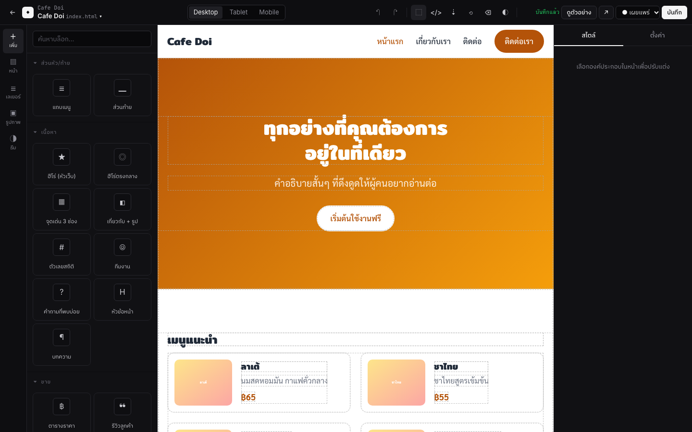</td><td width="50%">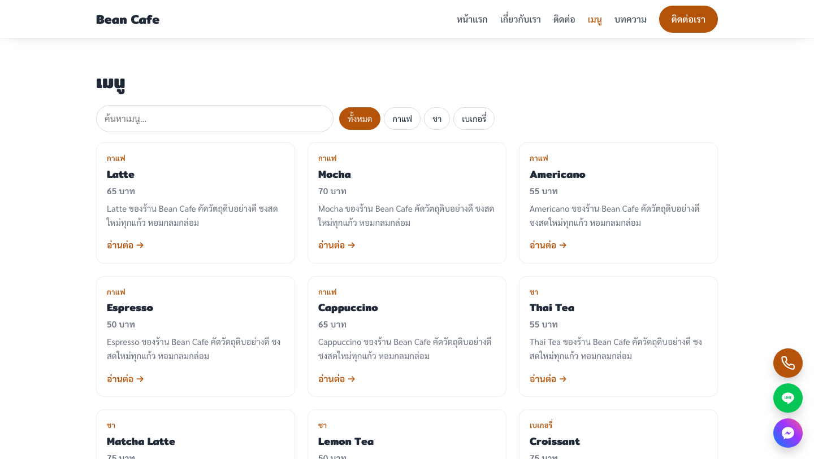</td></tr>
<tr><td><b>ตัวออกแบบลากวาง</b> — บล็อกสำเร็จรูป, ธีม, แถบเมนู, แอนิเมชัน, มือถือ/แท็บเล็ต</td><td><b>เว็บจากข้อมูล</b> — การ์ด, ค้นหา, หมวดหมู่, แบ่งหน้า, หน้ารายละเอียดทุกแถว</td></tr>
<tr><td>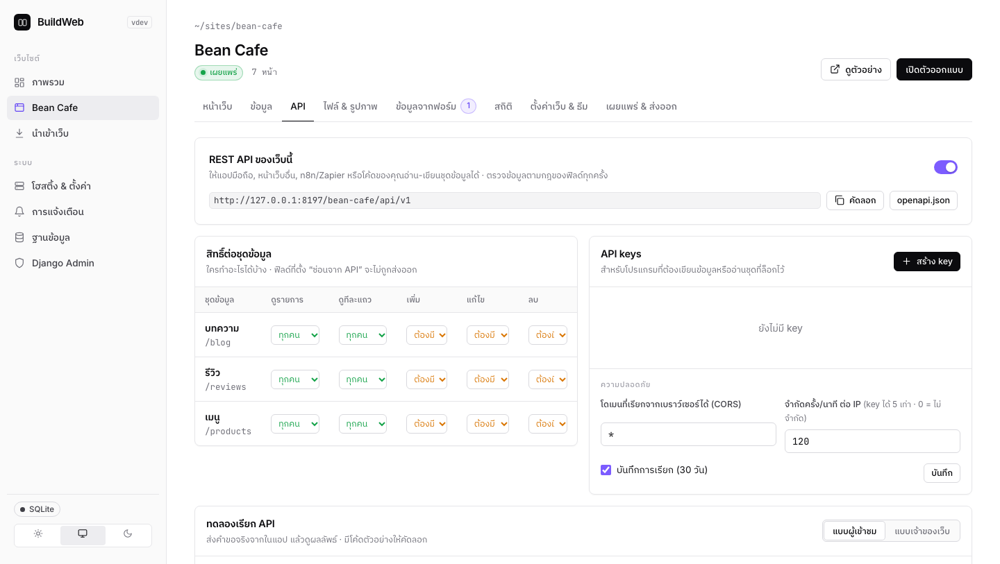</td><td>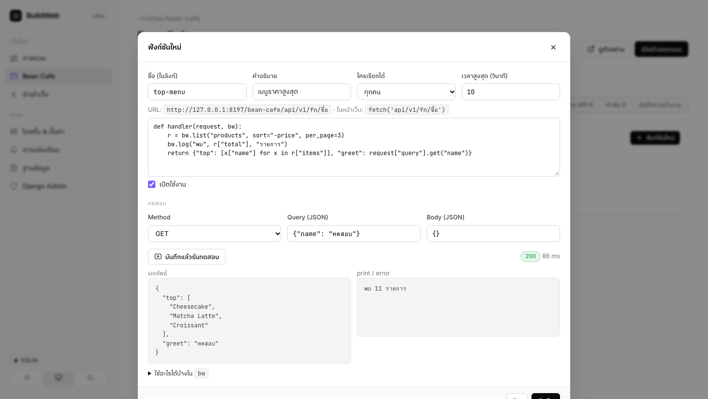</td></tr>
<tr><td><b>REST API อัตโนมัติ</b> — key, สิทธิ์, CORS, ทดลองเรียกในแอป, OpenAPI</td><td><b>Logic</b> — ฟังก์ชัน Python, webhooks, งานตั้งเวลา, ดึง API ภายนอก</td></tr>
<tr><td>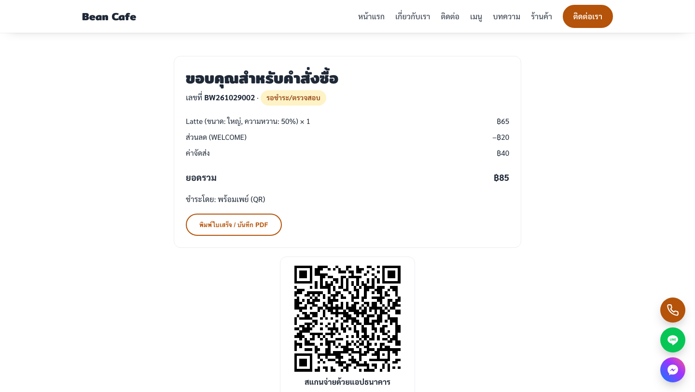</td><td>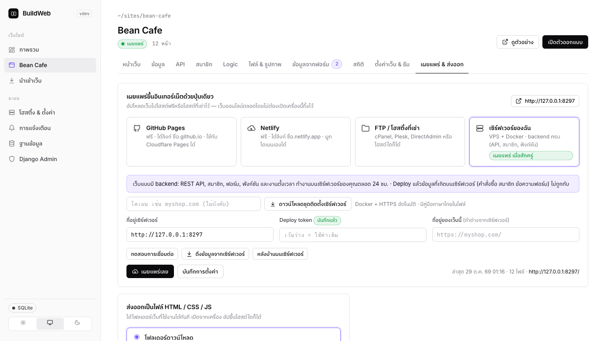</td></tr>
<tr><td><b>ร้านค้าออนไลน์</b> — ตะกร้า, พร้อมเพย์ QR, สลิป, Stripe, จัดการออเดอร์</td><td><b>เผยแพร่ทุกแบบ</b> — โฮสต์เอง, GitHub Pages, Netlify, FTP, VPS ของคุณ</td></tr>
</table>

### ภาพรวมความสามารถ

| หมวด | ทำอะไรได้ |
|---|---|
| [ออกแบบ](#1-ออกแบบหน้าเว็บ) | ลากวาง, แม่แบบ 5 แบบ, บล็อก 20+ แบบ, ธีมสี/ฟอนต์, แถบเมนู 4 แบบ, แอนิเมชัน 11 แบบ, บล็อกของฉัน, กล่องโค้ด HTML |
| [หน้าเว็บ & SEO](#2-หน้าเว็บ-seo-และการตลาด) | จัดการหน้า, เมนูย่อย, คะแนน SEO, sitemap/robots, ตัวอย่างตอนแชร์, สถิติผู้เข้าชม, ปุ่มติดต่อลอย |
| [ข้อมูล](#3-ข้อมูล-และ-mysql--xampp) | ชุดข้อมูล, นำเข้าจาก XAMPP/.sql/CSV, เชื่อมสดกับ MySQL, ฟิลด์พร้อมกฎ, ความสัมพันธ์ระหว่างข้อมูล |
| [เว็บจากข้อมูล](#4-เว็บจากข้อมูล-บล็อก-และฟอร์ม) | การ์ด/ตาราง, หน้ารายละเอียดทุกแถว, ค้นหา/หมวด/แบ่งหน้า, บล็อก + RSS, ฟอร์มพร้อมระบบอนุมัติ |
| [REST API](#5-rest-api) | CRUD ทุกชุดข้อมูล, API key, สิทธิ์ต่อการกระทำ, CORS, จำกัดความถี่, บันทึก, OpenAPI, JS SDK |
| [สมาชิก](#6-ระบบสมาชิก) | สมัคร/ล็อกอิน/ลืมรหัส/ยืนยันอีเมล, บทบาท, หน้าเฉพาะสมาชิก, ข้อมูลของใครของมัน |
| [Logic](#7-logic-ฝั่งเซิร์ฟเวอร์) | ฟังก์ชัน Python, webhooks (ลงลายเซ็น), งานตั้งเวลา, ดึงข้อมูลจาก API ภายนอก, ค่าลับ |
| [ร้านค้า](#8-ร้านค้าออนไลน์) | สินค้า + ตัวเลือก, ตะกร้า, คูปอง, ชำระเงิน (พร้อมเพย์/โอน/ปลายทาง/บัตร), สต็อก, ออเดอร์, ใบเสร็จ, อีเมลถึงลูกค้า, แจ้งเตือน LINE |
| [เผยแพร่](#9-เผยแพร่และโฮสติ้ง) | โฮสต์จากเครื่อง + Tailscale, GitHub Pages, Netlify, FTP, ส่งออก HTML, XAMPP htdocs |
| [เซิร์ฟเวอร์ของคุณ](#10-เซิร์ฟเวอร์ของฉัน-docker--vps) | ชุดติดตั้ง Docker + HTTPS, deploy ไม่ทับข้อมูลจริง, PostgreSQL, หลายโดเมน |
| [ทีม & ความปลอดภัย](#11-ทีม-สำรองข้อมูล-และความปลอดภัย) | หลายผู้ใช้ 3 บทบาท, โหมด CMS ให้ลูกค้า, ประวัติการแก้ไข, สำรองอัตโนมัติ, เข้ารหัสค่าลับ |

---

### 1. ออกแบบหน้าเว็บ

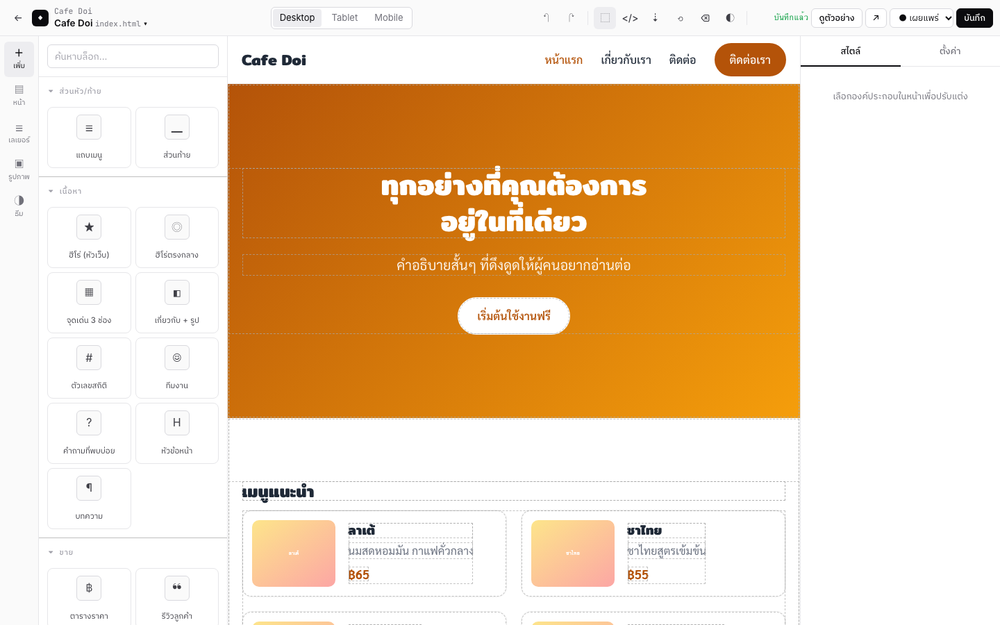

- **ลากวางแบบ Canva** บนตัวออกแบบ GrapesJS: ดับเบิลคลิกเพื่อพิมพ์/เปลี่ยนรูป, ลากบล็อกลงหน้า, ปรับสไตล์ที่แถบขวา, ดูแบบคอม/แท็บเล็ต/มือถือ, เลิกทำ/ทำซ้ำ, ประวัติเวอร์ชันของหน้า
- **แม่แบบเริ่มต้น:** ธุรกิจ, คาเฟ่, พอร์ตโฟลิโอ, แลนดิ้งเพจ, หน้าว่าง
- **บล็อกสำเร็จรูป:** ฮีโร่, จุดเด่น, เกี่ยวกับ, สถิติ, แกลเลอรี, ราคา, รีวิว, ทีม, FAQ, CTA, ฟอร์มติดต่อ, เมนูร้าน, สไลด์รูป, แถบโลโก้วิ่ง, ข้อความพิมพ์ทีละตัว และบล็อกจากข้อมูล/สมาชิก
- **ธีมทั้งเว็บ:** สี 7 ค่า, ฟอนต์ไทย/อังกฤษ 22 แบบ, ความโค้งมุม, ความกว้างเนื้อหา — บล็อกทุกอันเปลี่ยนตาม
- **แถบเมนูที่ตั้งค่าได้:** 4 รูปแบบ, โลโก้รูป/ข้อความ, ติดด้านบน/ใสแล้วทึบเมื่อเลื่อน/ซ่อนเมื่อเลื่อนลง, เมนูมือถือ 3 แบบ, เมนูย่อย, ปุ่ม CTA, แถบประกาศด้านบน
- **แอนิเมชัน:** โผล่เมื่อเลื่อนมาถึง 11 แบบ, โผล่ทีละชิ้น, ตอนชี้เมาส์ 6 แบบ, ตัวเลขนับขึ้น, พิมพ์ทีละตัว, parallax — เคารพการตั้งค่า “ลดการเคลื่อนไหว” ของผู้ชม
- **ส่วนหัว/ท้ายร่วม:** แก้ครั้งเดียวเปลี่ยนทุกหน้า แต่ละหน้าเลือกไม่ใช้ได้
- **บล็อกของฉัน:** กดดาวบนแถบเครื่องมือของส่วนที่เลือก → ใช้ซ้ำได้ทุกหน้าทุกเว็บ
- **กล่องโค้ด HTML:** วาง embed YouTube, Google Maps, Facebook หรือโค้ดของคุณเอง
- **นำเข้าเว็บที่มีอยู่:** จาก `.html`, `.zip`, ทั้งโฟลเดอร์ หรือ repo GitHub — หน้าแก้แบบลากวางได้ทันที ส่วนหัว/ท้ายที่ซ้ำกันแยกให้อัตโนมัติ

### 2. หน้าเว็บ, SEO และการตลาด

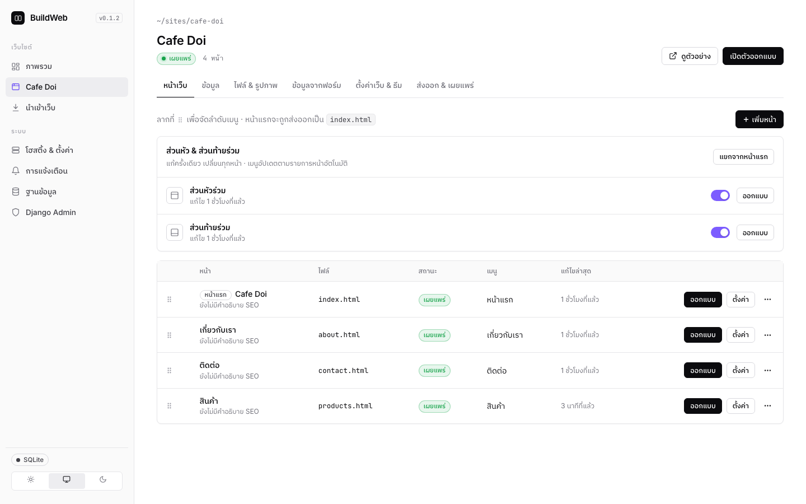

- จัดการหน้า: ฉบับร่าง/เผยแพร่, หน้าแม่ (เมนูย่อย), ลากจัดลำดับเมนู, ตั้งหน้าแรก, ทำสำเนา
- **คะแนน SEO ทุกหน้า** พร้อมคำแนะนำภาษาไทย: ชื่อเรื่อง, คำอธิบาย, H1, รูปไม่มี alt, ความยาวเนื้อหา, ลิงก์เสีย
- **ตัวอย่างตอนแชร์ลง Facebook/LINE**, `sitemap.xml`, `robots.txt`, canonical, og:image สร้างให้อัตโนมัติ
- **สถิติผู้เข้าชม** จากเซิร์ฟเวอร์ของคุณเอง ไม่ใช้คุกกี้: กราฟรายวัน, หน้ายอดนิยม, แหล่งที่มา, มือถือ/คอม
- **ปุ่มติดต่อลอย:** โทร, LINE, Messenger, WhatsApp, Facebook, อีเมล, แผนที่ — 3 รูปแบบ พร้อมตัวอย่างสด

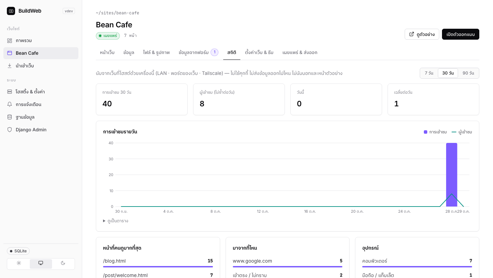

### 3. ข้อมูล และ MySQL / XAMPP

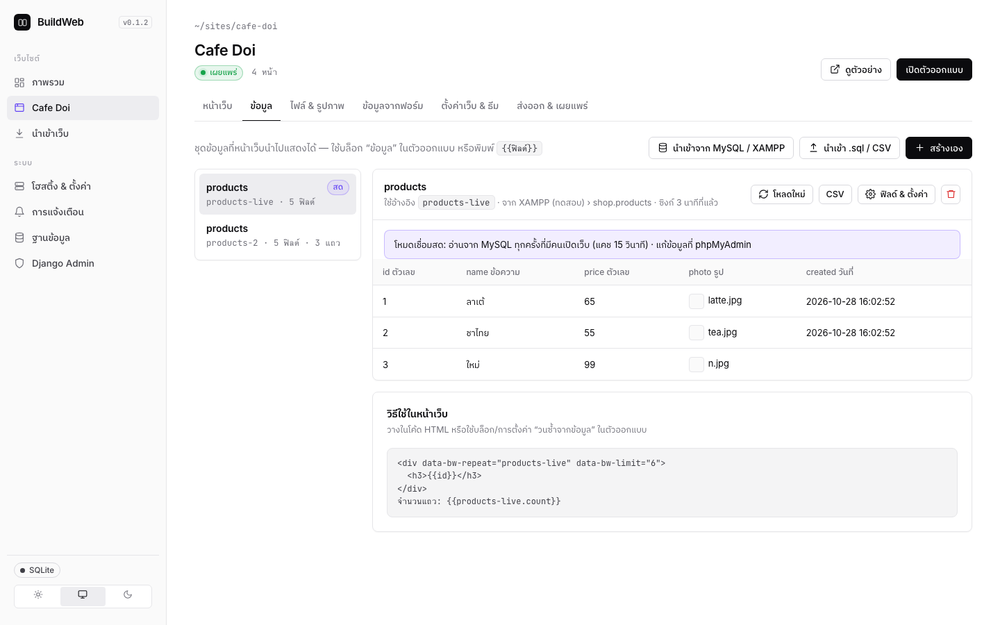

- **ชุดข้อมูล** (เหมือนตาราง) สร้างเอง หรือนำเข้าจาก **MySQL/XAMPP** (เลือกฐานข้อมูล › ตาราง), ไฟล์ `.sql` จาก phpMyAdmin หรือ CSV
- **2 โหมด:** คัดลอกมาเก็บในแอป หรือ **เชื่อมสด** อ่าน-เขียนตาราง MySQL จริง (แก้ใน phpMyAdmin แล้วเว็บเปลี่ยนตาม)
- **ฟิลด์ 13 ชนิด:** ข้อความ, ข้อความยาว, HTML, ตัวเลข, ใช่/ไม่, วันที่, วันเวลา, อีเมล, ลิงก์, รูป, ตัวเลือก, **เชื่อมชุดข้อมูล (relation)**, JSON
- **กฎของฟิลด์:** จำเป็น, ห้ามซ้ำ, ค่าเริ่มต้น, ต่ำสุด/สูงสุด, regex, ซ่อนจาก API — ตรวจเหมือนกันทุกทาง (แอป, ฟอร์ม, API)
- แก้ในตาราง หรือเปิดหน้าต่างแก้ทีละแถวพร้อมตัวแก้ไขข้อความและปุ่มเลือกรูป · ส่งออก CSV

### 4. เว็บจากข้อมูล, บล็อก และฟอร์ม

- ลากบล็อก **การ์ด/ตาราง** ของชุดข้อมูล หรือตั้งกล่องใดก็ได้ให้ “วนซ้ำจากข้อมูล” แล้วใส่ `{{ฟิลด์}}`
- **หน้ารายละเอียดของทุกแถว** ในคลิกเดียว: `products.html` → `product/latte.html` พร้อมปุ่มก่อนหน้า/ถัดไป และ SEO ต่อแถว
- **ค้นหา · ปุ่มหมวดหมู่ · แบ่งหน้า/โหลดเพิ่ม** ทำงานได้ทั้งตอนโฮสต์และหลังส่งออก
- **ระบบบทความ:** หน้ารวม, หน้าอ่าน, หมวดหมู่ และ **RSS** ในคลิกเดียว
- **ฟอร์ม:** ข้อความเข้าแอปพร้อมแจ้งเตือน, ส่ง CSV ได้, หรือ **บันทึกลงชุดข้อมูลพร้อมระบบอนุมัติ** (รีวิว, สมัคร, ลงทะเบียน) · กันสแปมด้วย honeypot และจำกัดความถี่

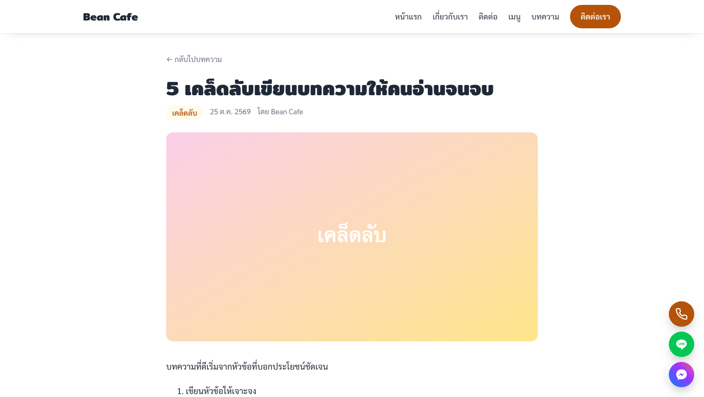

### 5. REST API

ทุกชุดข้อมูลมี API ให้ทันทีที่ `https://<เว็บ>/api/v1/<ชุดข้อมูล>` สำหรับแอปมือถือ ระบบหลังร้าน n8n/Zapier หรือโค้ดของคุณ

```bash
# อ่าน: 6 รายการราคาสูงสุดที่ราคาเกิน 50
curl 'https://myshop.com/api/v1/products?sort=-price&per_page=6&filter=price>50'

# เขียน: ต้องใช้ API key ที่มีสิทธิ์เขียน
curl -X POST 'https://myshop.com/api/v1/bookings' \
  -H 'X-API-Key: bw_xxxxxxxx' -H 'Content-Type: application/json' \
  -d '{"name": "สมชาย", "date": "2026-11-01", "people": 4}'
```

- **CRUD ครบ:** list, ดูทีละแถว, เพิ่ม, แก้ (PATCH/PUT), ลบ · แบ่งหน้า, เรียง, ค้นหา, กรอง, เลือกฟิลด์, `expand` แถวที่เชื่อม
- **สิทธิ์ต่อชุดข้อมูล × การกระทำ:** ทุกคน / สมาชิก / เจ้าของแถว / ต้องมี key / ปิด
- **API key** อ่านอย่างเดียวหรืออ่าน+เขียน, จำกัดชุดข้อมูล, ยกเลิกได้ทันที, เก็บแค่แฮช
- CORS ตามโดเมน, จำกัดครั้งต่อนาที, บันทึกการเรียก 30 วัน, **OpenAPI 3.1** (เปิดใน Postman/Swagger ได้)
- แท็บ “API” มี **ตัวทดลองเรียก** พร้อมโค้ดตัวอย่าง curl / fetch / PHP / Python
- **ในหน้าเว็บ:** `bw.list('products', {sort: '-price'})` · `bw.create(...)` · `bw.update(...)` · `bw.remove(...)`
- API ปิดไว้ก่อนเสมอ ต้องเปิดเองที่แท็บ API

### 6. ระบบสมาชิก

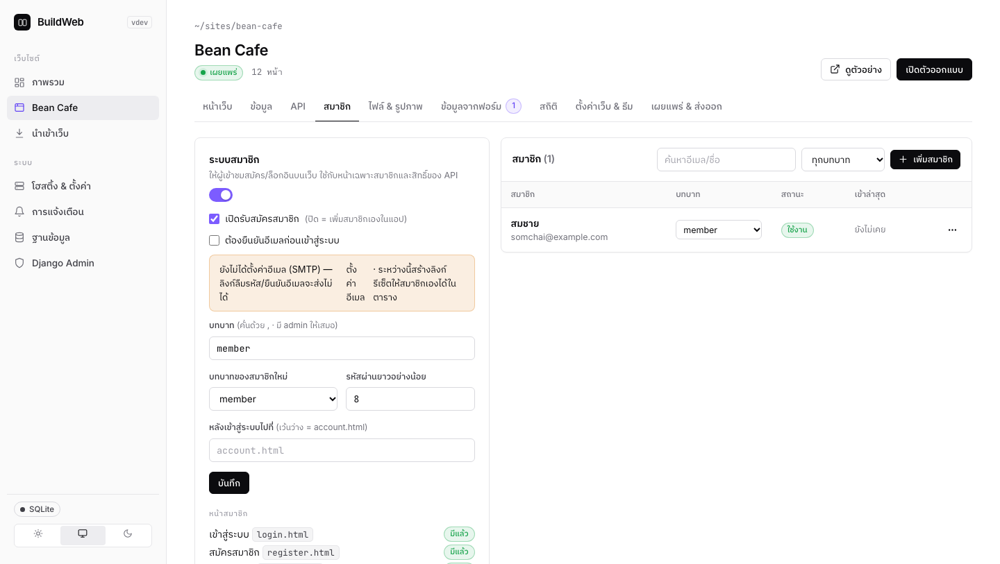

- สมัคร · เข้าสู่ระบบ · ออกจากระบบ · ลืมรหัสผ่าน (ลิงก์ทางอีเมล) · ยืนยันอีเมล · บัญชีของฉัน — **สร้างหน้าให้ครบในคลิกเดียว**
- **บทบาท** (member, vip, staff… + admin) และ **หน้าเฉพาะสมาชิก/เฉพาะบทบาท**
- **ข้อมูลของใครของมัน:** เช่น คำสั่งซื้อ โน้ต การจอง — แต่ละคนเห็นและแก้ได้แค่ของตัวเอง
- ในหน้าเว็บ: `{{user.name}}`, `data-bw-if="user"` / `"!user"`, บล็อกปุ่มสมาชิก ฟอร์มล็อกอิน ฟอร์มสมัคร
- จัดการสมาชิกในแอป: ค้นหา, เปลี่ยนบทบาท, ระงับ, ออกจากระบบทุกอุปกรณ์, สร้างลิงก์ตั้งรหัสผ่านใหม่
- ปลอดภัย: รหัสผ่าน PBKDF2, คุกกี้ HttpOnly + SameSite, จำกัดการเดารหัส, ลืมรหัสไม่เปิดเผยว่ามีบัญชีหรือไม่

### 7. Logic ฝั่งเซิร์ฟเวอร์

```python
# แท็บ Logic › ฟังก์ชัน › เรียกที่ POST /api/v1/fn/book-table
def handler(request, bw):
    body = request["body"]
    taken = bw.list("bookings", filter=f"date={body['date']}")["total"]
    if taken >= 20:
        return 409, {"error": "วันนี้เต็มแล้ว"}
    booking = bw.create("bookings", body)
    bw.http("POST", "https://api.line.me/v2/bot/message/push",
            headers={"Authorization": "Bearer " + bw.secret("LINE_TOKEN")},
            json={"to": bw.secret("LINE_ADMIN"), "messages": [{"type": "text", "text": f"จองใหม่ #{booking['_id']}"}]})
    return 201, booking
```

| | |
|---|---|
| **ฟังก์ชัน** | Python เป็น endpoint ของคุณเอง · อ่าน-เขียนข้อมูลผ่าน `bw` · เรียก API ภายนอก · รันในโปรเซสแยกพร้อมจำกัดเวลา · ตัวแก้โค้ดพร้อมปุ่มทดสอบ ดูผลและ `print` |
| **Webhooks** | ส่ง JSON ทันทีเมื่อ เพิ่ม/แก้/ลบแถว, ส่งฟอร์ม, สมาชิกใหม่ · ลายเซ็น HMAC-SHA256 · ลองซ้ำ 3 ครั้ง |
| **งานตั้งเวลา** | `every 15m` · `hourly` · `daily 09:00` · `weekly mon 09:00` → เรียก URL, ซิงก์ MySQL, ดึง API, รันฟังก์ชัน, ลบข้อมูลเก่า |
| **ดึงข้อมูลจาก API** | JSON จาก POS, Google Sheets (Apps Script), ระบบสต็อก → ชุดข้อมูล · อัปเดตตามคีย์ · ดูตัวอย่างก่อนนำเข้า |
| **ค่าลับ** | token / API key ใช้ในเซิร์ฟเวอร์เท่านั้น (`{{secret.NAME}}`) เข้ารหัสในฐานข้อมูล |
| **บันทึกการทำงาน** | ทุกการส่ง webhook, งาน, ฟังก์ชัน พร้อมรายละเอียดคำขอและผลลัพธ์ |

### 8. ร้านค้าออนไลน์

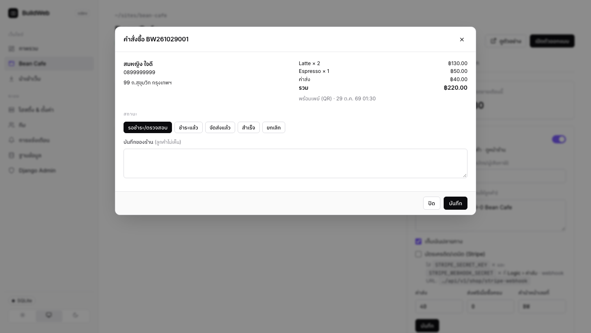

- **สร้างร้านในคลิกเดียว:** หน้าร้าน, หน้าสินค้า, ตะกร้า, ชำระเงิน, หน้าติดตามคำสั่งซื้อ, ปุ่มตะกร้าลอย, สินค้าตัวอย่าง
- **ชำระเงิน:** **พร้อมเพย์ QR** (ยอดเงินในคิวอาร์ ตามมาตรฐาน Thai QR) · โอนผ่านธนาคาร + แนบสลิป · เก็บเงินปลายทาง · บัตรเครดิต/เดบิตผ่าน **Stripe**
- **ปลอดภัย:** ราคาและสต็อกคำนวณที่เซิร์ฟเวอร์ทุกครั้ง · ลิงก์ติดตามออเดอร์มีรหัสลับ · Stripe ยืนยันด้วย webhook ที่ตรวจลายเซ็น
- **สต็อก** ตัดเมื่อสั่ง คืนเมื่อยกเลิก · แจ้งเตือนสินค้าใกล้หมด · ส่งฟรีเมื่อซื้อครบ · เลขที่คำสั่งซื้อรันอัตโนมัติ
- **คูปองส่วนลด** (%/บาท, ขั้นต่ำ, จำนวนครั้ง, หมดอายุ) · **ตัวเลือกสินค้า** ไซซ์/สี (`ไซซ์: S, M, L | สี: ดำ, ขาว`)
- **อีเมลยืนยันคำสั่งซื้อและแจ้งสถานะถึงลูกค้า** · **พิมพ์ใบเสร็จ/บันทึก PDF** · **ส่งออกคำสั่งซื้อ CSV**
- **แท็บ “ร้านค้า”:** ยอดขายวันนี้/เดือนนี้, รอตรวจสอบ, ค้นหา, ดูสลิป, เปลี่ยนสถานะ, บันทึกของร้าน
- **แจ้งเตือนออเดอร์ใหม่/สลิปเข้า** ทาง LINE, Telegram, Discord, อีเมล · สมาชิกดูออเดอร์ของตัวเองได้

### 9. เผยแพร่และโฮสติ้ง

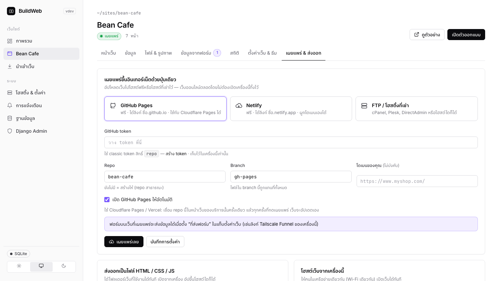

| วิธี | ได้อะไร | เหมาะกับ |
|---|---|---|
| **โฮสต์จากเครื่องนี้** | ทุกเว็บที่ `http://<IP>:8090/<เว็บ>/` + พอร์ตเฉพาะเว็บ · backend ครบ | ทดสอบ, ใช้ในออฟฟิศ |
| **Tailscale** | `https://<เครื่อง>.ts.net/` ในเครือข่ายคุณ หรือ **Funnel** ให้คนทั่วไปเข้า | ใช้งานจริงแบบไม่ต้องเช่าเซิร์ฟเวอร์ |
| **GitHub Pages** | `ชื่อ.github.io` ฟรี · ใช้ต่อกับ Cloudflare Pages/Vercel ได้ | เว็บหน้าร้าน/แลนดิ้ง (ไฟล์อย่างเดียว) |
| **Netlify** | `ชื่อ.netlify.app` ฟรี · ผูกโดเมนเองได้ | เว็บหน้าร้าน/แลนดิ้ง (ไฟล์อย่างเดียว) |
| **FTP / FTPS** | อัปโหลดไปโฮสติ้งที่เช่าไว้ (cPanel, Plesk, DirectAdmin) | มีโฮสติ้งอยู่แล้ว |
| **เซิร์ฟเวอร์ของฉัน** | VPS + Docker + HTTPS · **backend ครบทุกอย่าง** | ร้านค้า, เว็บสมาชิก, งานลูกค้า |
| **ส่งออกไฟล์** | โฟลเดอร์/zip ของ HTML/CSS/JS หรือวางลง **XAMPP htdocs** | ส่งงาน, เปิดจากเครื่อง |

> GitHub Pages / Netlify / FTP / ส่งออก เป็นไฟล์อย่างเดียว — REST API, สมาชิก, ร้านค้า และฟังก์ชันต้องใช้ “โฮสต์จากเครื่องนี้” หรือ “เซิร์ฟเวอร์ของฉัน”

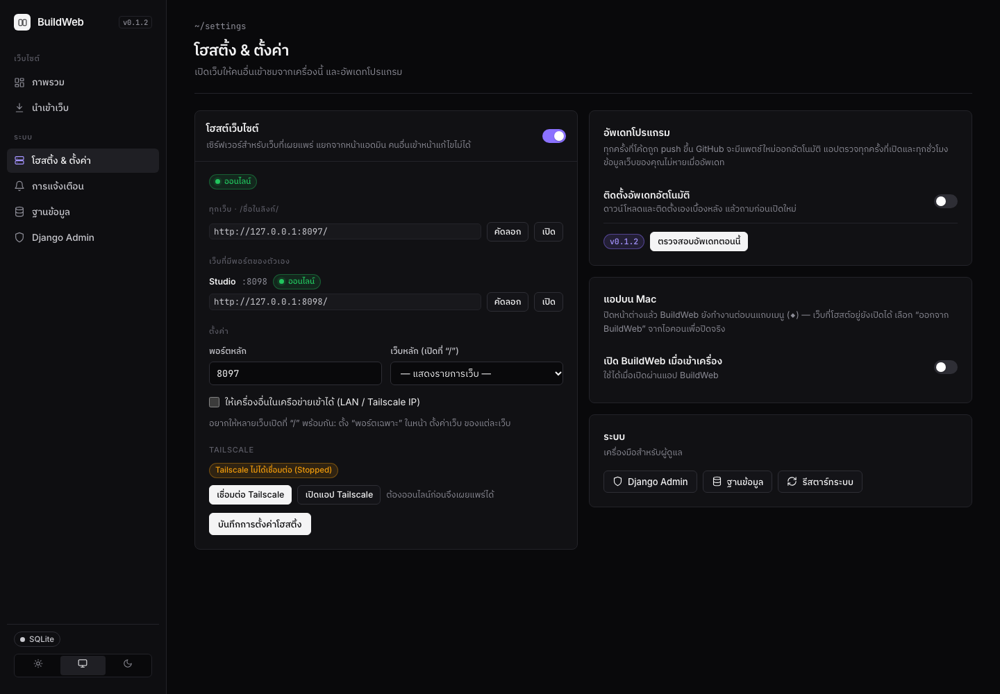

### 10. เซิร์ฟเวอร์ของฉัน (Docker / VPS)

ให้เว็บที่มี backend ออนไลน์ 24 ชม. บนเซิร์ฟเวอร์ของคุณ โดยยังออกแบบในแอปเหมือนเดิม

1. แท็บ “เผยแพร่ & ส่งออก” › **เซิร์ฟเวอร์ของฉัน** › ใส่โดเมน › **ดาวน์โหลดชุดติดตั้งเซิร์ฟเวอร์**
2. บน VPS (Ubuntu/Debian ใดก็ได้, RAM 1 GB ขึ้นไป):
   ```bash
   curl -fsSL https://get.docker.com | sh
   cd buildweb-server && docker compose up -d --build
   ```
3. ในแอปใส่ที่อยู่เซิร์ฟเวอร์ + deploy token (ในไฟล์ `.env`) แล้วกด **เผยแพร่เลย**

- **Deploy ไม่ทับข้อมูลจริง:** หน้า ธีม เนื้อหา ฟังก์ชัน และ API keys อัปเดต แต่คำสั่งซื้อ สมาชิก ข้อความฟอร์ม และสถิติบนเซิร์ฟเวอร์อยู่ครบ · สำรองของเดิมให้ก่อนทุกครั้ง
- **ดึงข้อมูลจากเซิร์ฟเวอร์** กลับมาดูในแอป · หลังบ้านบนเซิร์ฟเวอร์ที่ `/__bw/admin/`
- HTTPS อัตโนมัติด้วย Caddy · **PostgreSQL** (มีใน docker-compose), MySQL หรือ SQLite · หลายเว็บหลายโดเมนในเซิร์ฟเวอร์เดียว

### 11. ทีม, สำรองข้อมูล และความปลอดภัย

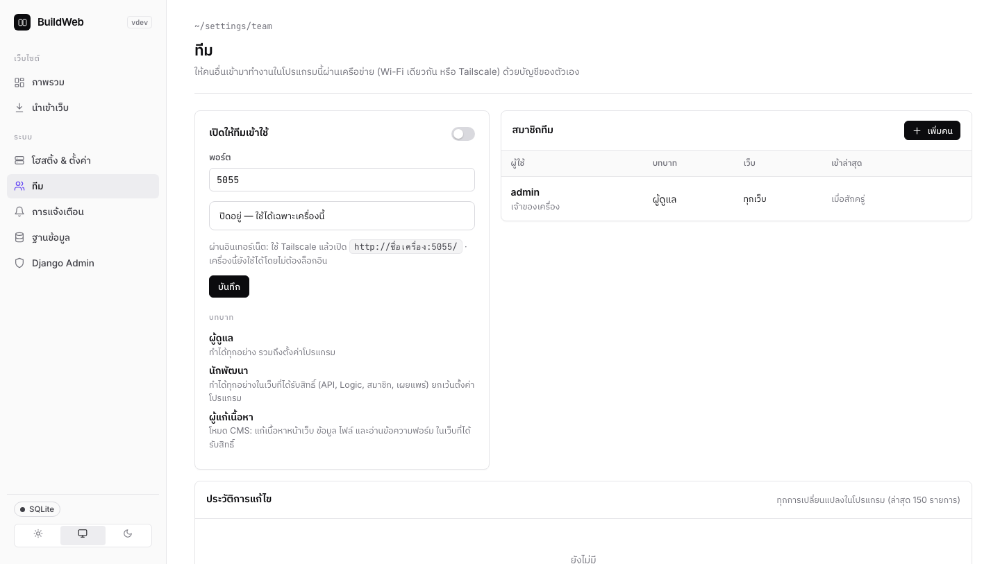

- **รูปภาพ:** รูปที่อัปโหลดใหญ่เกิน 2000px ถูกย่อและเก็บเป็น WebP อัตโนมัติ เว็บโหลดเร็วขึ้น · ปุ่ม “ย่อรูปที่มีอยู่”
- **ทีม:** เปิดให้คนอื่นใช้แอปผ่าน Wi-Fi/Tailscale ด้วยบัญชีของตัวเอง (จำกัดการเดารหัสผ่าน)
  - **ผู้ดูแล** ทำได้ทุกอย่าง · **นักพัฒนา** ทำได้ทุกอย่างในเว็บที่ได้รับ · **ผู้แก้เนื้อหา** = โหมด CMS สำหรับลูกค้า แก้หน้า ข้อมูล ไฟล์ และดูออเดอร์/ฟอร์มได้เท่านั้น
  - **ประวัติการแก้ไข:** ใคร ทำอะไร เมื่อไร
- **สำรอง & กู้คืน:** ทั้งเว็บในไฟล์ `.bwsite` เดียว · สำรองอัตโนมัติวันละครั้ง (เก็บ 14 ชุด) · กู้คืนในคลิกเดียว · ย้ายเครื่องด้วย “นำเข้าเว็บ”
- **ฐานข้อมูลของแอป:** SQLite (ค่าเริ่มต้น) หรือ MySQL/MariaDB ของ XAMPP ย้ายข้อมูลให้ในคลิกเดียว · ถ้า MySQL ดับ แอปเข้าโหมดปลอดภัย
- **การแจ้งเตือน:** เดสก์ท็อป, LINE, Telegram, Discord, อีเมล (SMTP), Webhook — มีปุ่มทดสอบทุกช่องทาง
- **ความปลอดภัย:** ตัวออกแบบเปิดเฉพาะในเครื่อง · เซิร์ฟเวอร์โฮสติ้งเห็นเฉพาะเว็บที่เผยแพร่ · ค่าลับ/รหัสผ่านในฐานข้อมูลถูกเข้ารหัส · API key และ token เก็บแค่แฮช

---

## เริ่มใช้งานใน 5 นาที

1. **สร้างเว็บ:** หน้า “ภาพรวม” › **สร้างเว็บใหม่** › ตั้งชื่อ › เลือกแม่แบบ
2. **ออกแบบ:** ดับเบิลคลิกข้อความเพื่อพิมพ์ · ลากบล็อกจากแถบซ้ายลงหน้า · เลือกองค์ประกอบแล้วปรับที่แถบขวา
3. **แต่งทั้งเว็บ:** แท็บ “ตั้งค่าเว็บ & ธีม” (สี/ฟอนต์/ปุ่มติดต่อ) · แท็บ “หน้าเว็บ” › **ตั้งค่าแถบเมนู**
4. **ใส่ข้อมูล:** แท็บ “ข้อมูล” › สร้างเอง หรือนำเข้าจาก XAMPP › กด **สร้างหน้ารายการ + รายละเอียด**
5. **เผยแพร่:** “โฮสติ้ง & ตั้งค่า” › เปิดโฮสติ้ง หรือแท็บ “เผยแพร่ & ส่งออก” › เลือกปลายทาง › **เผยแพร่เลย**

### แท็บในหน้าจัดการเว็บ

| แท็บ | ใช้ทำอะไร |
|---|---|
| หน้าเว็บ | รายการหน้า, ส่วนหัว/ท้ายร่วม, แถบเมนู, คะแนน SEO |
| ข้อมูล | ชุดข้อมูล, นำเข้า, ฟิลด์และกฎ, อนุมัติข้อมูลจากฟอร์ม, สร้างหน้าจากข้อมูล, ระบบบทความ |
| ร้านค้า | สร้างร้าน, ตั้งค่าการชำระเงิน, คำสั่งซื้อ, ยอดขาย |
| API | เปิด REST API, สิทธิ์, API keys, ทดลองเรียก, เอกสาร, บันทึก |
| สมาชิก | ตั้งค่าระบบสมาชิก, บทบาท, หน้าสมาชิก, รายชื่อสมาชิก |
| Logic | ฟังก์ชัน, webhooks, งานตั้งเวลา, ดึงข้อมูลจาก API, ค่าลับ, บันทึกการทำงาน |
| ไฟล์ & รูปภาพ | อัปโหลด, โฟลเดอร์, alt text |
| ข้อมูลจากฟอร์ม | ข้อความที่ผู้เข้าชมส่ง, ส่งออก CSV |
| สถิติ | ผู้เข้าชม 7/30/90 วัน |
| ตั้งค่าเว็บ & ธีม | ชื่อ, ที่อยู่เว็บจริง, ธีม, ปุ่มติดต่อลอย, โค้ดเพิ่มเติม |
| เผยแพร่ & ส่งออก | ปลายทางเผยแพร่, เซิร์ฟเวอร์ของฉัน, ส่งออกไฟล์, สำรอง & กู้คืน |

### คีย์ลัดในตัวออกแบบ

| คีย์ | ทำอะไร |
|---|---|
| `⌘/Ctrl + S` | บันทึก (ปกติบันทึกอัตโนมัติอยู่แล้ว) |
| `⌘/Ctrl + Z` · `⇧ + ⌘/Ctrl + Z` | เลิกทำ · ทำซ้ำ |
| `⌘/Ctrl + C` · `⌘/Ctrl + V` | คัดลอก · วางองค์ประกอบ |
| `Delete` / `Backspace` | ลบองค์ประกอบที่เลือก |
| ดับเบิลคลิก | แก้ข้อความ / เปลี่ยนรูป / แก้โค้ด HTML / เปิดส่วนหัว-ท้ายร่วม |

---

## สูตรสำเร็จ: ทำเว็บแบบต่างๆ

<details open><summary><b>ร้านกาแฟ เมนูจาก XAMPP</b></summary>

1. สร้างเว็บจากแม่แบบ “คาเฟ่”
2. แท็บ “ข้อมูล” › นำเข้าจาก MySQL / XAMPP › เลือกตาราง `menu` › **เชื่อมสด**
3. กด **สร้างหน้ารายการ + รายละเอียด** — ได้ `menu.html` (ค้นหา + หมวดหมู่) และหน้าของทุกเมนู
4. แท็บ “ตั้งค่าเว็บ” › ปุ่มติดต่อลอย › ใส่เบอร์โทรและ LINE @
5. แก้ราคาใน phpMyAdmin → หน้าเว็บเปลี่ยนตามภายใน 15 วินาที
</details>

<details><summary><b>ร้านค้าออนไลน์รับพร้อมเพย์</b></summary>

1. แท็บ “ร้านค้า” › **สร้างร้านค้า** › ใส่เบอร์พร้อมเพย์และบัญชีธนาคาร
2. แท็บ “ข้อมูล” › สินค้า › เพิ่มสินค้า รูป ราคา สต็อก
3. “การแจ้งเตือน” › ใส่ LINE Messaging API เพื่อรับแจ้งออเดอร์
4. เผยแพร่ด้วย “เซิร์ฟเวอร์ของฉัน” หรือโฮสต์จากเครื่อง + Tailscale Funnel
5. ลูกค้าสั่ง → สแกน QR → แนบสลิป → คุณกด “ชำระแล้ว” ในแท็บร้านค้า
</details>

<details><summary><b>เว็บสมาชิก / คอร์สออนไลน์</b></summary>

1. แท็บ “สมาชิก” › เปิดระบบสมาชิก › **สร้างหน้าสมาชิก** › เพิ่มบทบาท `vip`
2. สร้างหน้าบทเรียน › ตั้งค่าหน้า › “ใครเปิดหน้านี้ได้” = เฉพาะบทบาท vip
3. ลากบล็อก “ปุ่มสมาชิก” ไปไว้ที่แถบเมนู
4. ตั้ง SMTP ใน “การแจ้งเตือน” เพื่อส่งอีเมลลืมรหัสผ่าน
</details>

<details><summary><b>รับงานลูกค้าแบบมืออาชีพ</b></summary>

1. ออกแบบและทำ backend ในแอปของคุณ (ข้อมูล, API, ฟังก์ชัน, webhooks ไป n8n ของลูกค้า)
2. ดาวน์โหลดชุดติดตั้งเซิร์ฟเวอร์ → ติดตั้งบน VPS ของลูกค้า → Deploy
3. เมนู “ทีม” › เพิ่มบัญชีลูกค้าเป็น **ผู้แก้เนื้อหา** ให้เฉพาะเว็บนั้น
4. ลูกค้าแก้ข้อความ รูป และข้อมูลได้เอง แต่แตะ API/Logic/ตั้งค่าไม่ได้ · ดูประวัติการแก้ไขได้ทุกเมื่อ
5. แก้ดีไซน์ภายหลัง → Deploy ซ้ำ ข้อมูลจริงบนเซิร์ฟเวอร์ไม่หาย
</details>

<details><summary><b>เชื่อมกับแอปมือถือหรือระบบอื่น</b></summary>

1. แท็บ “API” › เปิด REST API › ตั้งสิทธิ์ › สร้าง API key แบบอ่าน+เขียน
2. ดาวน์โหลด `openapi.json` ไปเปิดใน Postman หรือสร้างโค้ด client
3. ให้ระบบอื่นรู้เมื่อมีข้อมูลใหม่ด้วย Logic › Webhooks
</details>

---

## คู่มืออ้างอิง

### ไวยากรณ์ข้อมูลในหน้าเว็บ

```html
<!-- วนซ้ำทุกแถวของชุดข้อมูล "products" พร้อมค้นหา หมวดหมู่ และแบ่งหน้า -->
<div data-bw-repeat="products" data-bw-sort="price" data-bw-order="desc" data-bw-limit="24"
     data-bw-filter="category=coffee;price>50" data-bw-search="ค้นหาเมนู…" data-bw-facet="category"
     data-bw-paginate="9" data-bw-empty="ยังไม่มีสินค้า">
  <a class="card" href="{{_url}}">
    
    <h3>{{name}}</h3>
    <p>฿{{price|number}} · {{detail|truncate:80}}</p>
    <small>โดย {{author.name}} · {{date|date}}</small>
  </a>
</div>
<p>ทั้งหมด {{products.count}} รายการ · © {{now.year}} {{site.name}}</p>
<p data-bw-if="user">สวัสดี {{user.name}}</p>
```

| ใช้ | ความหมาย |
|---|---|
| `data-bw-repeat="slug"` | วนซ้ำเนื้อหาข้างในทุกแถว |
| `data-bw-limit` · `data-bw-offset` | จำนวนแถวสูงสุด · ข้ามกี่แถว |
| `data-bw-sort` + `data-bw-order="desc"` | เรียงตามฟิลด์ |
| `data-bw-filter` | `=` `!=` `~` (มีคำนี้) `>` `<` `>=` `<=` คั่นด้วย `;` |
| `data-bw-search` · `data-bw-facet` · `data-bw-paginate` · `data-bw-pager="more"` | ช่องค้นหา · ปุ่มหมวด · แบ่งหน้า · ปุ่มโหลดเพิ่ม |
| `data-bw-empty` | ข้อความเมื่อไม่มีแถว |
| `data-bw-mine` | เฉพาะแถวของสมาชิกที่ล็อกอิน |
| `data-bw-if="field"` · `"!field"` | แสดงเมื่อมีค่า · ไม่มีค่า (ใช้ `user` ได้) |
| `{{field}}` · `{{{field}}}` · `{{#}}` · `{{_id}}` | ค่า · HTML ไม่ escape · ลำดับ · รหัสแถว |
| `{{relation.field}}` | ค่าจากแถวที่เชื่อม เช่น `{{author.name}}` |
| `{{_url}}` · `{{_prev_url}}` · `{{_next_url}}` | ลิงก์หน้ารายละเอียด · ก่อนหน้า · ถัดไป |
| `\|number` `\|number:2` · `\|date` `\|date:en` · `\|truncate:120` · `\|text` · `\|default:…` | ตัวแปลงค่า |
| `{{slug.count}}` · `{{slug.field}}` | จำนวนแถว · ค่าแถวแรก |
| `{{site.name}}` · `{{page.title}}` · `{{now.year}}` · `{{user.name}}` `{{user.email}}` `{{user.role}}` | ค่าทั่วไป |

`{{...}}` ที่หาค่าไม่เจอจะถูกปล่อยไว้ตามเดิม เว็บที่นำเข้ามาซึ่งใช้ `{{ }}` ของ Vue/Handlebars จึงไม่พัง

### แอตทริบิวต์ฟอร์ม สมาชิก และร้านค้า

| ใช้ | ความหมาย |
|---|---|
| `<form data-bw-collection="reviews">` | บันทึกลงชุดข้อมูล (เปิด “รับข้อมูลจากฟอร์ม” ในชุดนั้นก่อน) · `data-bw-success` / `data-bw-pending` ข้อความตอบกลับ |
| `<form data-bw-auth="login\|register\|forgot\|reset\|profile\|password">` | ฟอร์มสมาชิก · `data-bw-redirect` ไปหน้าที่ต้องการหลังสำเร็จ |
| `data-bw-logout` | ปุ่มออกจากระบบ |
| `data-bw-add-to-cart="{{_id}}" data-name data-price data-image` | ปุ่มใส่ตะกร้า · `data-bw-qty-from=".qty"` อ่านจำนวนจากช่อง |
| `[data-bw-cart]` · `form[data-bw-checkout]` · `[data-bw-order]` · `[data-bw-cart-count]` | ตะกร้า · ชำระเงิน · หน้าคำสั่งซื้อ · ตัวเลขจำนวนในตะกร้า |

### แอตทริบิวต์แอนิเมชัน

| แอตทริบิวต์ | ค่า |
|---|---|
| `data-bw-anim` | `fade` `fade-up` `fade-down` `fade-left` `fade-right` `zoom-in` `zoom-out` `flip-up` `blur` `rise` `pop` |
| `data-bw-anim-duration` · `data-bw-anim-delay` | มิลลิวินาที (ค่าเริ่มต้น 700 · 0) |
| `data-bw-anim-once="false"` | เล่นซ้ำทุกครั้งที่เลื่อนมาถึง |
| `data-bw-stagger="120"` | ชิ้นด้านในโผล่ทีละชิ้น ห่างกัน 120ms |
| `data-bw-hover` | `lift` `grow` `glow` `zoom-img` `tilt` `shine` |
| `data-bw-count` · `data-bw-typing="คำ1\|คำ2"` · `data-bw-parallax="0.3"` | นับเลขขึ้น · พิมพ์ทีละตัว · parallax |

### REST API

| Endpoint | |
|---|---|
| `GET /api/v1/` | รายการชุดข้อมูลที่เรียกได้ |
| `GET /api/v1/openapi.json` | เอกสาร OpenAPI 3.1 |
| `GET /api/v1/<ชุด>` | `page` `per_page`(≤200) `sort=-price,name` `q` `filter` `ฟิลด์=ค่า` `expand` `fields` |
| `POST /api/v1/<ชุด>` | เพิ่ม → `201` |
| `GET` · `PATCH` · `PUT` · `DELETE /api/v1/<ชุด>/<_id>` | ดู · แก้บางฟิลด์ · แทนที่ · ลบ (`204`) |
| `GET/POST /api/v1/fn/<ชื่อ>` | เรียกฟังก์ชันของคุณ |

ผลลัพธ์รายการ: `{"items": [...], "page", "per_page", "total", "total_pages"}` · แต่ละแถวมี `_id` `_created` `_updated` (และ `_mine` เมื่อเป็นของสมาชิกที่ล็อกอิน)

ข้อผิดพลาด: `{"error": {"code", "message", "fields"}}` — `401` ต้องใช้ key/ล็อกอิน · `403` ไม่มีสิทธิ์ · `404` · `422` ข้อมูลไม่ผ่านกฎ (บอกทุกช่อง) · `429` เรียกถี่เกิน

ยืนยันตัวตน: `X-API-Key: bw_…` หรือ `Authorization: Bearer bw_…` (API key) · `Authorization: Bearer bwu_…` (สมาชิก)

### ระบบสมาชิกและร้านค้า (API)

| Endpoint | |
|---|---|
| `POST /api/v1/auth/register` · `login` · `logout` | สมัคร · เข้าสู่ระบบ (ได้ `token` + คุกกี้) · ออก |
| `POST /api/v1/auth/forgot` · `reset` · `GET auth/verify?token=` | ลืมรหัส · ตั้งรหัสใหม่ · ยืนยันอีเมล |
| `GET` · `PATCH /api/v1/auth/me` | ข้อมูลของฉัน · แก้ชื่อ/โปรไฟล์/รหัสผ่าน (`current_password` + `new_password`) |
| `GET /api/v1/shop/config` | วิธีชำระเงินและค่าส่ง |
| `GET /api/v1/shop/coupon?code=&subtotal=` | ตรวจคูปองและดูส่วนลด |
| `POST /api/v1/shop/checkout` | `{items: [{id, qty, options}], customer, phone, email, address, note, payment, coupon}` → เลขที่ + token + payload พร้อมเพย์ / URL Stripe |
| `GET /api/v1/shop/orders/<เลขที่>?t=<token>` · `POST …/slip` | ดูคำสั่งซื้อ · แนบสลิป |
| `GET /api/v1/shop/my-orders` | คำสั่งซื้อของสมาชิกที่ล็อกอิน |
| `POST /api/v1/shop/stripe-webhook` | สำหรับ Stripe (ตรวจลายเซ็นด้วย `STRIPE_WEBHOOK_SECRET`) |

### ฟังก์ชัน: สิ่งที่ใช้ได้ใน `bw`

```python
bw.list("orders", sort="-_id", per_page=10)   # {"items": [...], "total": ...}
bw.all("orders", filter="status=pending")      # ทุกแถว (ดึงทุกหน้าให้)
bw.get("orders", 12) · bw.create("orders", {...}) · bw.update("orders", 12, {...}) · bw.delete("orders", 12)
bw.http("POST", url, json={...}, headers={...})  # {"status", "json", "text"}
bw.secret("NAME") · bw.log("ข้อความ") / print(...)
# request = {"method", "query", "body", "headers", "user"}
# return {...}  หรือ  return 201, {...}
```

### Webhook: รูปแบบและการตรวจลายเซ็น

```json
{"event": "record.created", "site": "my-shop", "collection": "orders", "at": "2026-10-29T10:00:00+07:00", "data": {"_id": 12, "...": "..."}}
```

```python
import hashlib, hmac
def valid(raw_body: bytes, header: str, secret: str) -> bool:   # header = X-BuildWeb-Signature
    return hmac.compare_digest(header, "sha256=" + hmac.new(secret.encode(), raw_body, hashlib.sha256).hexdigest())
```

เหตุการณ์: `record.created` `record.updated` `record.deleted` `form.submitted` `member.registered` · header อื่น: `X-BuildWeb-Event`, `X-BuildWeb-Delivery`

### ตัวแปรของเซิร์ฟเวอร์ (`.env` ในชุดติดตั้ง)

| ตัวแปร | ความหมาย |
|---|---|
| `SITE_DOMAINS` | โดเมนที่ Caddy ขอ HTTPS ให้ (คั่นด้วยช่องว่าง) |
| `BUILDWEB_DOMAINS` | โดเมนไหนแสดงเว็บไหน เช่น `shop.com=my-shop,blog.com=my-blog` |
| `BUILDWEB_DEFAULT_SITE` | เว็บที่แสดงเมื่อโดเมนไม่อยู่ในรายการ |
| `BUILDWEB_DEPLOY_TOKEN` | รหัสที่แอปใช้ deploy (ใส่ในแอป) |
| `BUILDWEB_ADMIN_PASSWORD` | รหัสผ่านหลังบ้าน `/__bw/admin/` (ผู้ใช้ `admin`) |
| `BUILDWEB_DATABASE_URL` | `postgres://…` · `mysql://…` · `sqlite:////data/db.sqlite3` (ค่าเริ่มต้น: SQLite) |
| `BUILDWEB_HTTPS` | `1` = คุกกี้แบบ Secure (เปิดเมื่อมีโดเมน) |

---

## ทำงานอย่างไร

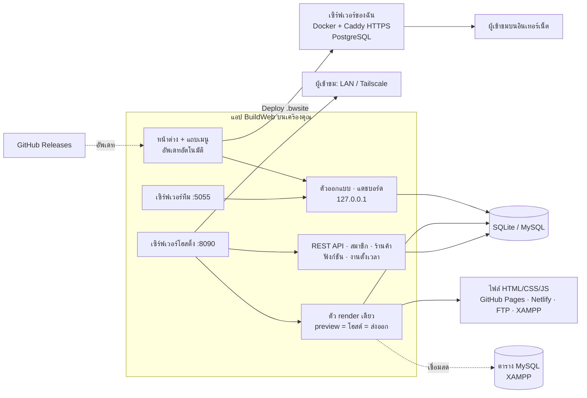

- **ตัว render เดียว:** หน้าที่เห็นในตัวอย่าง, หน้าที่โฮสต์ และไฟล์ที่ส่งออกมาจากโค้ดชุดเดียวกัน ใช้ลิงก์แบบ relative จึงเปิดได้ทุกที่
- **โค้ดชุดเดียวกันทั้งแอปและเซิร์ฟเวอร์:** สิ่งที่ทำงานในเครื่องคุณ ทำงานบน VPS เหมือนกันทุกอย่าง
- **แยกส่วนสาธารณะ:** ผู้เข้าชมเห็นเฉพาะเว็บที่เผยแพร่ ตัวออกแบบเปิดเฉพาะในเครื่อง (หรือผ่านเซิร์ฟเวอร์ทีมที่ต้องล็อกอิน)
- **ทนทาน:** บน macOS backend รันเป็นบริการแยก ไม่หยุดเมื่อปิดหน้าต่าง · MySQL ดับแล้วเข้าโหมดปลอดภัย · สำรองอัตโนมัติทุกวัน

---

## คำถามที่พบบ่อย / แก้ปัญหา

<details><summary><b>ข้อมูลเว็บเก็บที่ไหน? ย้ายเครื่องยังไง?</b></summary>

- macOS: `~/Library/Application Support/com.buildweb.app/data/`
- Windows: `%APPDATA%\com.buildweb.app\data\`
- Linux: `~/.local/share/com.buildweb.app/data/`

ย้ายเครื่อง: แท็บ “เผยแพร่ & ส่งออก” › **ดาวน์โหลดไฟล์สำรอง** (.bwsite) → เครื่องใหม่ “นำเข้าเว็บ” › เลือกไฟล์ · สำรองอัตโนมัติอยู่ในโฟลเดอร์ `backups/`
</details>
<details><summary><b>ต้องจ่ายเงินไหม?</b></summary>

แอปใช้ฟรี ค่าใช้จ่ายมีเฉพาะสิ่งที่คุณเลือกใช้เอง เช่น VPS (ประมาณ 150–200 บาท/เดือน), ชื่อโดเมน, ค่าธรรมเนียม Stripe · GitHub Pages, Netlify (แพ็กเกจฟรี), Tailscale (ส่วนตัว) และพร้อมเพย์ไม่มีค่าใช้จ่าย
</details>
<details><summary><b>เว็บของฉันเปิดได้จากที่ไหนบ้าง?</b></summary>

- คอม/มือถือใน Wi-Fi เดียวกัน: เปิดโฮสติ้ง แล้วใช้ลิงก์ `http://<IP>:8090/…`
- ทุกที่: Tailscale (เฉพาะอุปกรณ์ของคุณ) หรือ Tailscale Funnel / GitHub Pages / Netlify / FTP / เซิร์ฟเวอร์ของฉัน (ทุกคน)
</details>
<details><summary><b>API / สมาชิก / ร้านค้า ใช้บน GitHub Pages ได้ไหม?</b></summary>

ไม่ได้ เพราะ GitHub Pages, Netlify และ FTP เก็บได้แค่ไฟล์ ฟีเจอร์ที่ต้องมี backend ต้องโฮสต์จากเครื่องนี้ (Tailscale Funnel) หรือใช้ “เซิร์ฟเวอร์ของฉัน”
</details>
<details><summary><b>เชื่อม XAMPP ไม่ได้</b></summary>

- เปิด **MySQL Database** ใน XAMPP Control Panel ก่อน
- ค่ามาตรฐาน: host `127.0.0.1`, พอร์ต `3306`, ผู้ใช้ `root`, ไม่มีรหัสผ่าน
- Mac ชิป Apple กับ XAMPP รุ่น Intel ต้องติดตั้ง Rosetta: `softwareupdate --install-rosetta`
</details>
<details><summary><b>อีเมลลืมรหัสผ่านไม่ถูกส่ง</b></summary>

ตั้งค่า SMTP ที่ “การแจ้งเตือน” › อีเมล (เช่น Gmail ใช้ App Password, พอร์ต 587) · ระหว่างนั้นสร้างลิงก์ตั้งรหัสผ่านใหม่ให้สมาชิกได้ในแท็บ “สมาชิก”
</details>
<details><summary><b>QR พร้อมเพย์สแกนไม่ได้</b></summary>

ตรวจว่าใส่เบอร์มือถือ 10 หลัก หรือเลขบัตร/เลขผู้เสียภาษี 13 หลัก ที่ผูกพร้อมเพย์ไว้แล้ว ในแท็บ “ร้านค้า” · หน้าคำสั่งซื้อต้องต่ออินเทอร์เน็ตเพื่อโหลดตัววาด QR
</details>
<details><summary><b>Deploy แล้วข้อมูลบนเซิร์ฟเวอร์หายไหม?</b></summary>

ไม่หาย ชุดข้อมูลที่รับข้อมูลจากผู้ใช้ (ฟอร์ม, สิทธิ์เพิ่มข้อมูลเป็น ทุกคน/สมาชิก/เจ้าของแถว, คำสั่งซื้อ) สมาชิก ข้อความฟอร์ม และสถิติ จะอยู่ครบ และเซิร์ฟเวอร์สำรองของเดิมให้ก่อนทุกครั้งใน `/data/backups`
</details>
<details><summary><b>Tailscale ขึ้นว่า “ไม่ได้เชื่อมต่อ”</b></summary>
กดปุ่ม <b>เชื่อมต่อ Tailscale</b> ในหน้าโฮสติ้ง หรือเปิดแอป Tailscale แล้วกด Connect · BuildWeb เชื่อมลิงก์ให้เองภายใน 30 วินาที
</details>
<details><summary><b>นำเข้าเว็บ React/Vue ได้ไหม?</b></summary>
ได้ แต่ต้อง build ก่อน แล้วนำเข้าโฟลเดอร์ <code>dist/</code> หรือ <code>build/</code>
</details>

---

## แผนต่อไป

- [x] ออกแบบลากวาง, แถบเมนู, แอนิเมชัน, นำเข้าเว็บ, โฮสต์ + Tailscale (v0.1)
- [x] เว็บจากข้อมูล, บทความ, SEO, สถิติ, เผยแพร่ปุ่มเดียว (v0.1.4)
- [x] REST API (v0.2) · ระบบสมาชิก (v0.3) · Logic (v0.4) · เซิร์ฟเวอร์ของฉัน + สำรอง (v0.5) · ทีม (v0.6) · ร้านค้า (v0.7)
- [x] คูปอง, ตัวเลือกสินค้า, อีเมลถึงลูกค้า, ใบเสร็จ, ย่อรูป WebP, แก้ช่องโหว่ความปลอดภัย (v0.8)
- [ ] Omise / 2C2P · ใบกำกับภาษี · ราคาตามตัวเลือกสินค้า
- [ ] คลังรูปฟรี · แม่แบบเพิ่ม · หลายภาษา · ผู้ช่วย AI
- [ ] ลงนามแอปกับ Apple/Microsoft (ไม่มีคำเตือนตอนติดตั้ง)

ประวัติทุกเวอร์ชันอยู่ที่ [CHANGELOG.md](CHANGELOG.md)

---

<details>
<summary><b>สำหรับนักพัฒนา</b></summary>

| ส่วน | เทคโนโลยี |
|---|---|
| แอป | Tauri 2 (Rust): หน้าต่าง, ไอคอนแถบเมนู, อัพเดทอัตโนมัติ · macOS รัน backend เป็น launchd job |
| Backend | Django 5.2 LTS + waitress · PyMySQL (MariaDB 10.4 ของ XAMPP) · psycopg (PostgreSQL บนเซิร์ฟเวอร์) · cryptography |
| ตัวออกแบบ | GrapesJS 0.23 (เก็บไว้ใน `backend/builder/static/vendor/grapesjs`) |
| Python | แอปแนบ `uv` ไปด้วยและสร้าง venv ส่วนตัวตอนเปิดครั้งแรก (ติดตั้งใหม่เมื่อ requirements เปลี่ยน) |

```
backend/
  run.py                 แอปบนเครื่อง: migrate, โฮสติ้ง, ทีม, งานตั้งเวลา, ตัวออกแบบ
  server.py              แบบเซิร์ฟเวอร์ (Docker/VPS)
  buildweb/              settings, urls, config.json
  builder/
    render.py            Site → ไฟล์ (preview = โฮสต์ = ส่งออก)
    navbar.py anim.py    แถบเมนู · แอนิเมชัน
    data.py schema.py    ชุดข้อมูล, MySQL, ตัวแปลงค่า · ฟิลด์และการตรวจข้อมูล
    generate.py          หน้ารายการ/รายละเอียด, บทความ, หน้าสมาชิก, ร้านค้า
    restapi.py           REST API, auth, shop routes, ฟังก์ชัน
    members.py shop.py   สมาชิก · ร้านค้า (พร้อมเพย์, Stripe)
    logic.py fn_runner.py ค่าลับ, webhooks, งานตั้งเวลา, ดึง API · ตัวรันฟังก์ชัน
    backup.py crypto.py  .bwsite (สำรอง/กู้คืน/deploy) · เข้ารหัส
    server_api.py serverkit.py  /__bw/deploy|pull|health · ชุดติดตั้ง Docker
    team.py forms.py stats.py seo.py publish.py widgets.py
    sections.py importer.py hosting.py tailscale.py notify.py exporter.py dbtools.py system.py
    static/builder/      app.css, editor.js, site.js, icons.js
src-tauri/               แอป (Rust)
scripts/                 stage-backend, collect, publish, set-version
```

```sh
cd backend
uv venv --python 3.11 .venv && uv pip install --python .venv/bin/python -r requirements.txt
.venv/bin/python run.py                                        # http://127.0.0.1:5050
BUILDWEB_DATA=$(mktemp -d) .venv/bin/python manage.py test builder
BUILDWEB_DATA=/tmp/srv BUILDWEB_DEPLOY_TOKEN=… .venv/bin/python server.py   # ลองโหมดเซิร์ฟเวอร์
```

แอป: `npm install` แล้ว `npm run dev` · อัปเดต GrapesJS ด้วย `npm run vendor`

**ปล่อยเวอร์ชันใหม่ = push ขึ้น `main`.** [`release.yml`](.github/workflows/release.yml) รันเทสต์ แล้ว build และเซ็นทุกระบบพร้อมกัน (macOS arm64/x64, Windows, Linux) และปล่อยเป็น release เดียวใน [buildweb-releases](https://github.com/AImunich20/buildweb-releases/releases) พร้อม `latest.json`
- เลขเวอร์ชันขึ้นเอง (+1 patch) หรือตั้งเองด้วย `node scripts/set-version.js 0.8.0`
- ใส่ `[skip release]` ในข้อความ commit ถ้าไม่ต้องการปล่อย
- Secrets ที่ต้องตั้ง: `TAURI_SIGNING_PRIVATE_KEY` และ `RELEASES_TOKEN`
</details>
